[English](README.md) · [한국어](README.ko.md) · [简体中文](README.zh-CN.md) · [日本語](README.ja.md) · **Español**

<div align="center">


# Deskterior

Ordena el escritorio de tu Mac como ordenarías una mesa de verdad, en pixel art.

[](../../releases/latest)
[](../../actions/workflows/ci.yml)
[](#requisitos)
[](LICENSE)


<sub>Arriba: una grabación real de la pantalla de la app en un Mac. Las imágenes fijas de más abajo usan los iconos de archivo integrados de la mesa. En tu Mac, cada archivo muestra su propio icono o miniatura, en píxeles.</sub>

</div>

**Una mesa en pixel art que vive en el escritorio de tu Mac.** Deskterior cubre el escritorio con una pequeña habitación
iluminada, y los archivos de tu Escritorio aparecen como iconos en el monitor de la mesa. Recógelos como lo harías en
una mesa de verdad: mételos en los cajones del elevador del monitor o en el archivador, déjalos en el soporte del
teléfono o en el portalápices, tíralos al cesto de papeles, bárrelos con el cepillo bajo la alfombrilla de tela o,
simplemente, pulsa el botón de encendido del monitor. Esconder solo cambia la disposición. Tus archivos se quedan donde
están y solo cambian cuando lo pides expresamente.

La interfaz de la app está en inglés y en coreano, y sigue el idioma de tu Mac cuando es uno de esos dos; con cualquier
otro, español incluido, se muestra en inglés. Por eso, en esta página los menús, botones y ajustes de la app aparecen en
inglés, tal como los verás en pantalla.

[**Descarga la última versión**](../../releases/latest) · macOS 14 Sonoma o posterior · Apple silicon e Intel · gratis y
de código abierto (MIT)

- [Funciones](#funciones) · [Todo lo que hace](#todo-lo-que-hace) ·
  [Dónde se esconde cada cosa](#dónde-se-esconde-cada-cosa) · [Gestos](#gestos) ·
  [Tus archivos están a salvo](#tus-archivos-están-a-salvo)
- [Instalación](#instalación) · [Primer inicio](#primer-inicio) · [Ajustes](#ajustes) · [Modo seguro](#modo-seguro) ·
  [Desinstalar](#desinstalar)
- [Compilar desde el código fuente](#compilar-desde-el-código-fuente) · [Requisitos](#requisitos) ·
  [Limitaciones conocidas](#limitaciones-conocidas) · [Créditos](#créditos) · [Licencia](#licencia)

## Funciones

Cada clip de esta sección es una grabación real de la pantalla de Deskterior en un Mac. La lista completa está en
[Todo lo que hace](#todo-lo-que-hace).

### En el monitor

<table>
<tr>
<td valign="top">
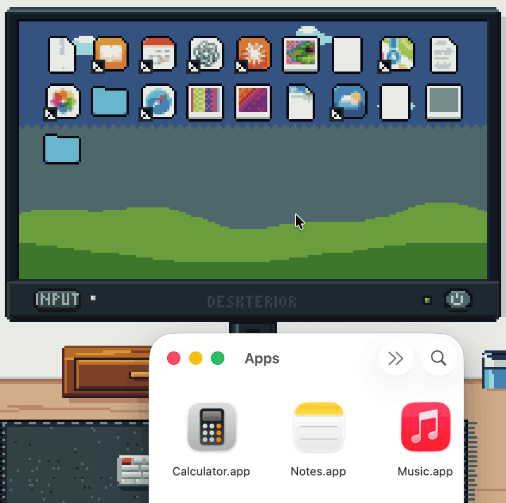
</td>
<td valign="top">
<b>Iconos reales, en píxeles</b><br>
Suelta apps o archivos del Finder en el monitor: sus iconos reales se convierten en iconos de píxeles.
</td>
</tr>
<tr>
<td valign="top">
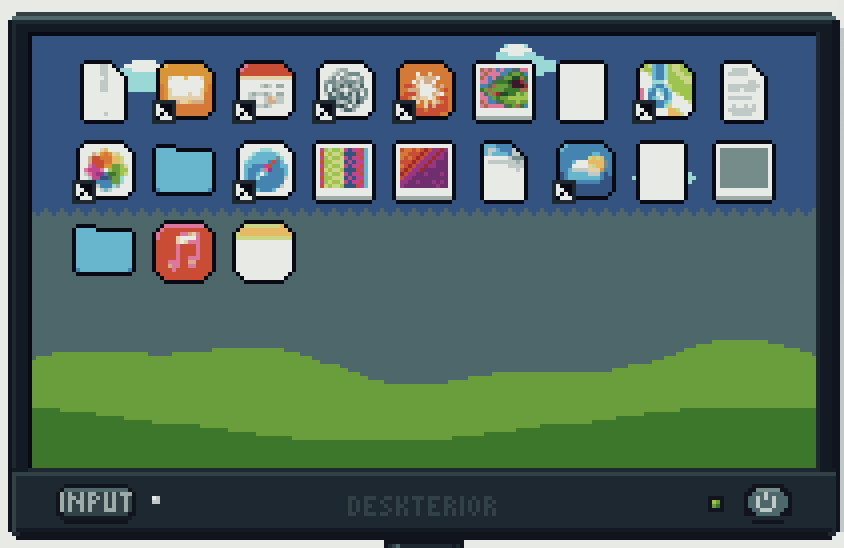
</td>
<td valign="top">
<b>Un botón de encendido de monitor CRT</b><br>
⏻ encoge la imagen como un viejo monitor de tubo (CRT) y oculta todos los archivos. Un archivo que llega mientras está apagado enciende la insignia ámbar +1.
</td>
</tr>
<tr>
<td valign="top">
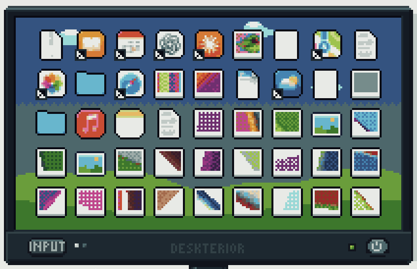
</td>
<td valign="top">
<b>INPUT y AV</b><br>
INPUT pasa por páginas HDMI de 45 archivos cada una. AV siempre está vacía: NO SIGNAL (sin señal).
</td>
</tr>
<tr>
<td colspan="2" valign="top">
<b>Más en el monitor</b><br>
Clean Up By (ordenar por) Name, Kind o Date Added · selecciona con un clic, ⌘-clic, un recuadro o ⌘A · teclas de flecha, barra espaciadora para Quick Look · un desplazamiento sobre la pantalla cambia de página.<br>
<a href="#todo-lo-que-hace">Todo lo que hace</a>
</td>
</tr>
</table>

### Escondites

<table>
<tr>
<td valign="top">
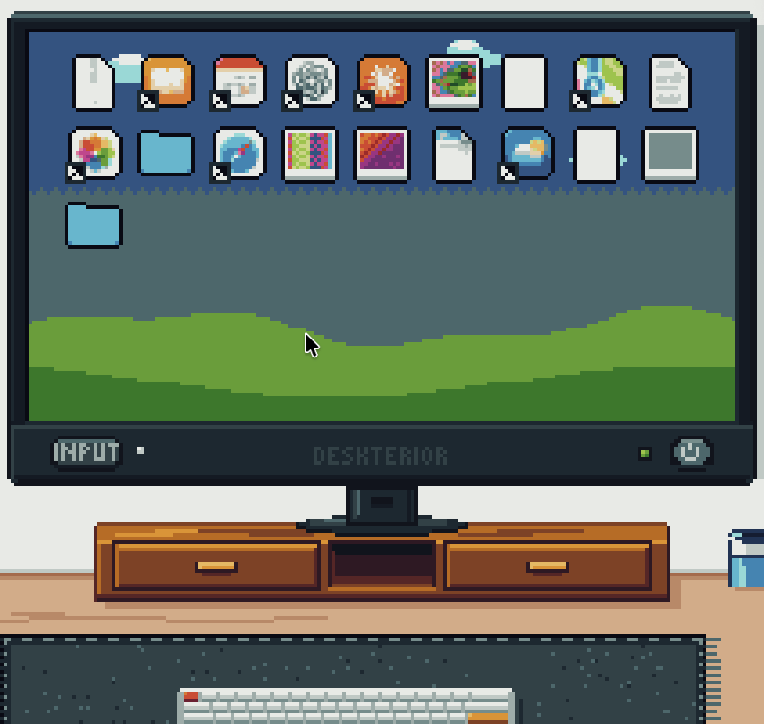
</td>
<td valign="top">
<b>Cajones del elevador y hueco</b><br>
Suelta un archivo sobre un cajón cerrado y se lo traga. Desplázate sobre uno para echar un vistazo; el hueco solo oculta a medias.
</td>
</tr>
<tr>
<td valign="top">
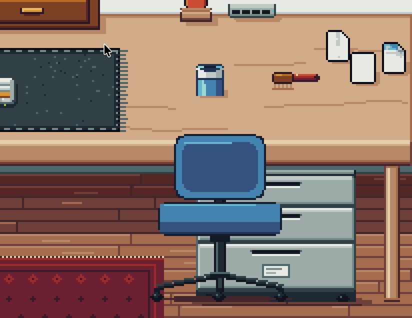
</td>
<td valign="top">
<b>Archivador y silla</b><br>
La silla bloquea el archivador: apártala y vuelve a tirar. El cajón de abajo archiva las cosas bajo pestañas de carpeta.
</td>
</tr>
<tr>
<td valign="top">
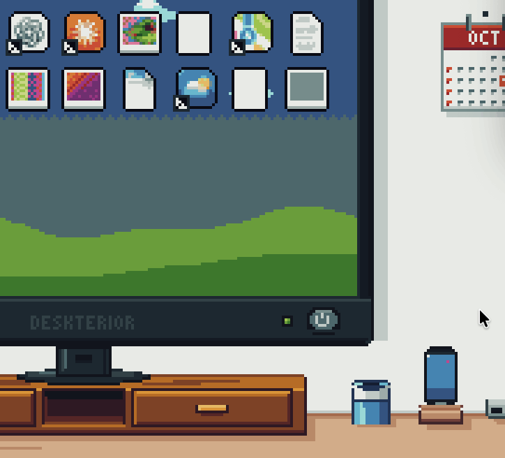
</td>
<td valign="top">
<b>Soporte del teléfono</b><br>
Los archivos se convierten en mini apps en el teléfono. Ponlo boca abajo para ocultarlas.
</td>
</tr>
<tr>
<td valign="top">
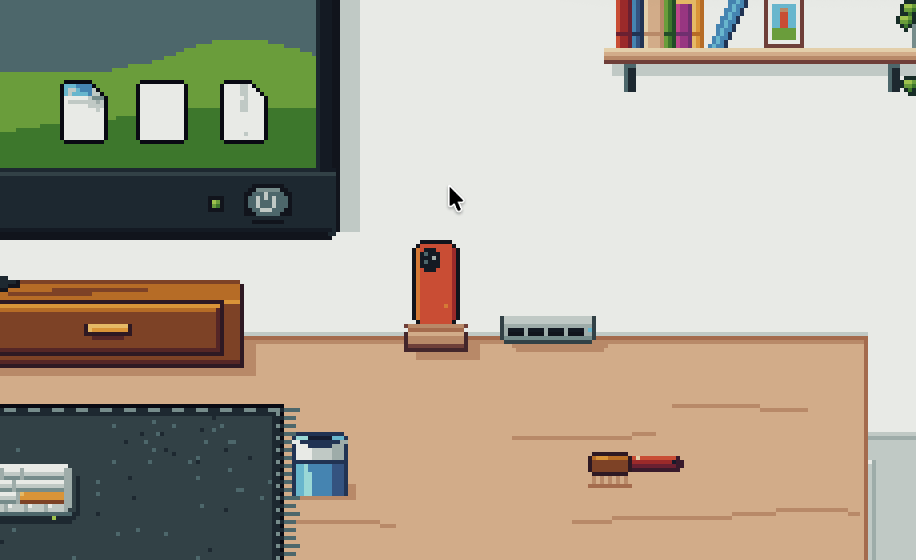
</td>
<td valign="top">
<b>Portalápices</b><br>
Los archivos se convierten en bolígrafos con el capuchón del color de su tipo. Arrástralo rápido y suéltalo: se vuelca y los desparrama.
</td>
</tr>
<tr>
<td valign="top">
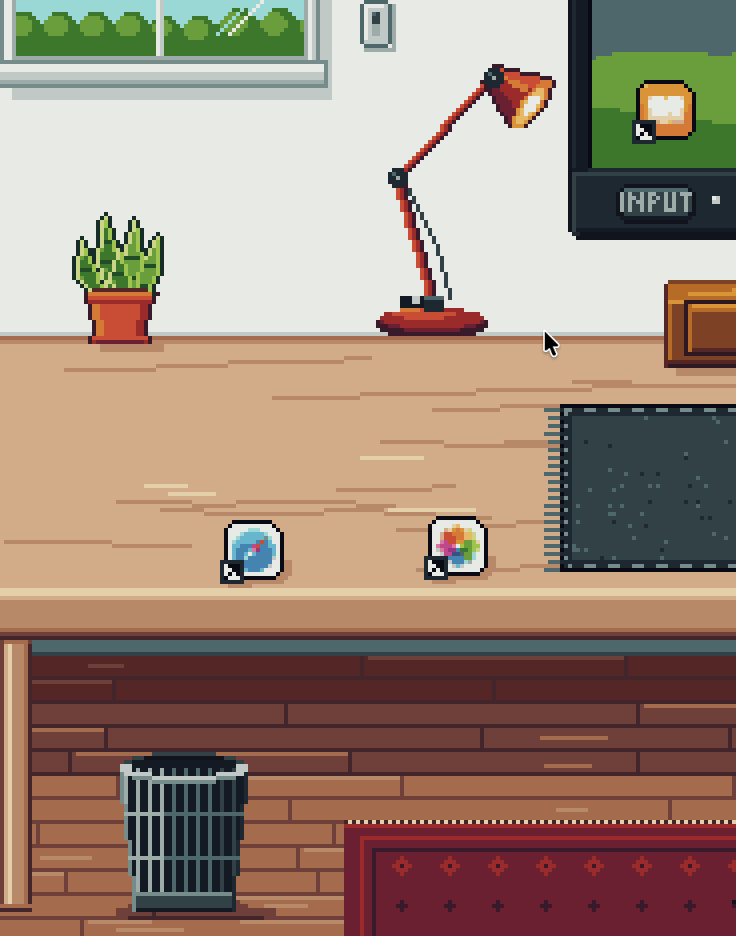
</td>
<td valign="top">
<b>Cesto de papeles</b><br>
Lanza un archivo dentro: SWISH! Vuelca el cesto y vuelve a ponerlo de pie. Oculto, no borrado.
</td>
</tr>
<tr>
<td colspan="2" valign="top">
<b>Más en los escondites</b><br>
Los cajones, el hueco y el teléfono enumeran su contenido, lo mueven o lo sacan todo desde sus menús · se ve lo llenos que están (un cajón demasiado lleno queda entreabierto y luego se atasca) · nada sale solo.<br>
<a href="#dónde-se-esconde-cada-cosa">Dónde se esconde cada cosa</a>
</td>
</tr>
</table>

### La alfombrilla

<table>
<tr>
<td valign="top">
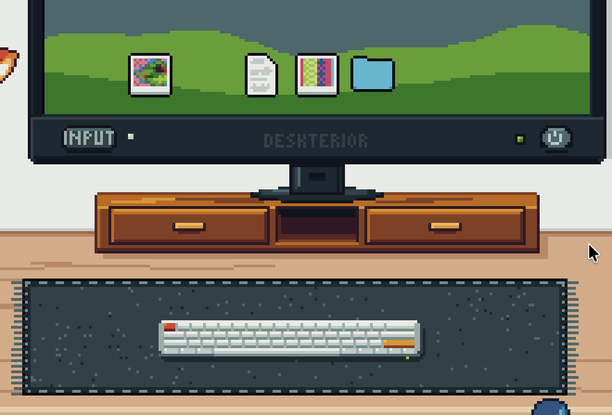
</td>
<td valign="top">
<b>Barrer bajo la alfombrilla</b><br>
Suelta archivos sobre la alfombrilla: se deslizan debajo y dejan bultos. Levanta el borde para sacar uno.
</td>
</tr>
<tr>
<td colspan="2" valign="top">
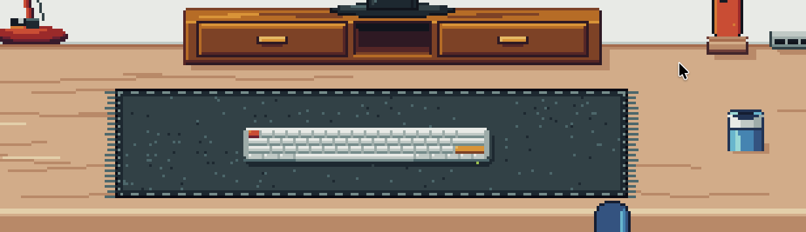<br>
<b>Un trozo de tela de verdad</b><br>
Llévala de un sitio a otro y se arruga. Arrastra con ⌥ para girarla o cambiarle el tamaño (el teclado gira con ella), dóblala y alísala de un tirón.
</td>
</tr>
<tr>
<td valign="top">
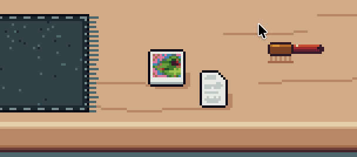
</td>
<td valign="top">
<b>Cepillo y escoba de desplazamiento</b><br>
Empuja los montones bajo la alfombrilla con el cepillo o con un desplazamiento lateral con dos dedos sobre la mesa.
</td>
</tr>
<tr>
<td colspan="2" valign="top">
<b>Más en la alfombrilla</b><br>
Peek Under · List Items Under Mat · Rotate, Size, Smooth, Reset Mat · un modo Flat que conserva los bultos sin levantarse.<br>
<a href="#gestos">Gestos</a>
</td>
</tr>
</table>

### Física

<table>
<tr>
<td valign="top">
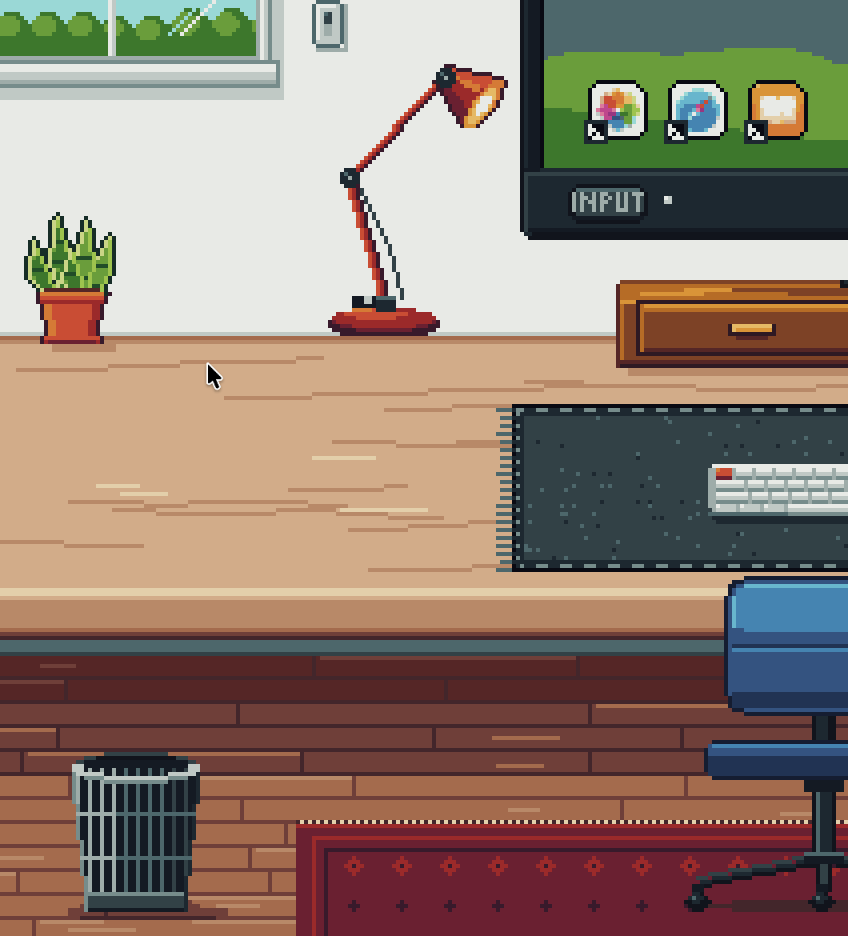
</td>
<td valign="top">
<b>Montones, el suelo y golpes</b><br>
Los archivos que dejas en la mesa se amontonan. Lanza uno al suelo; haz doble clic en el borde frontal de la mesa para darle un golpe.
</td>
</tr>
<tr>
<td colspan="2" valign="top">
<br>
<b>Clear the Desk</b><br>
Un solo ítem de menú, Clear the Desk (despejar la mesa), lo esconde todo: TIDY! Un solo ⌘Z lo devuelve todo a su sitio.
</td>
</tr>
</table>

### Luz

<table>
<tr>
<td colspan="2" valign="top">
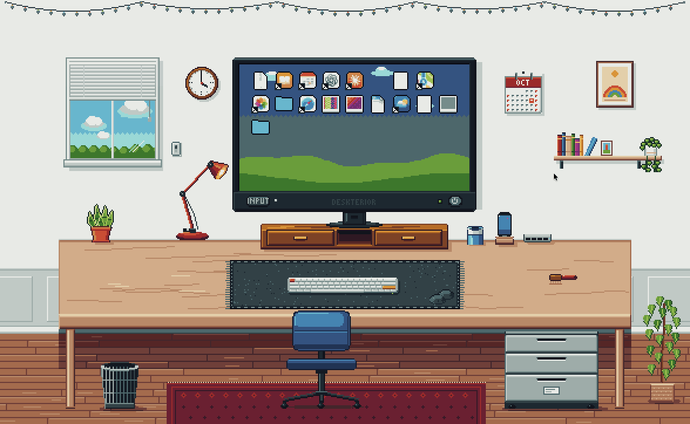<br>
<b>Night y Lamp Only</b><br>
Pon la luz en Night (noche), apaga el interruptor de la habitación para Lamp Only (solo la lámpara) y haz clic en la lámpara de mesa.
</td>
</tr>
<tr>
<td colspan="2" valign="top">
<b>Más sobre la luz</b><br>
Auto sigue el reloj por el día, el atardecer y la noche · arrastra el minutero del reloj para ver otra hora · en Lamp Only, los archivos a oscuras son siluetas que no puedes seleccionar.<br>
<a href="#todo-lo-que-hace">Todo lo que hace</a>
</td>
</tr>
</table>

### Archivos y búsqueda

<table>
<tr>
<td colspan="2" valign="top">
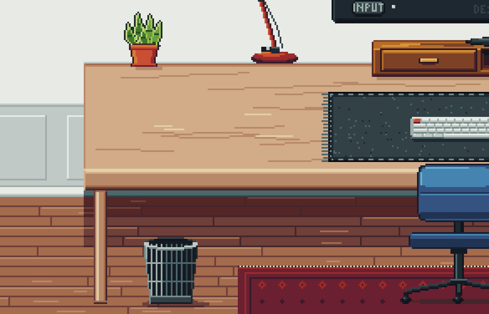<br>
<b>Find Item…</b><br>
⌘F enumera todos los archivos y dónde se esconden. Show on Desk (mostrar en la mesa) abre el escondite y señala el archivo.
</td>
</tr>
<tr>
<td valign="top">
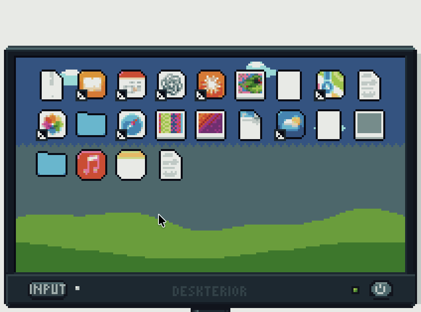
</td>
<td valign="top">
<b>Move to Trash, y de vuelta</b><br>
Move to Trash (trasladar a la Papelera) envía un archivo a la Papelera de macOS; ⌘Z lo devuelve al mismo sitio.
</td>
</tr>
<tr>
<td valign="top">
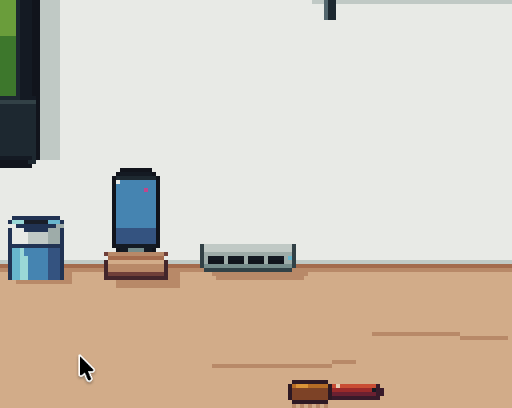
</td>
<td valign="top">
<b>Hub de unidades</b><br>
Una memoria USB se enchufa en el hub de la mesa. Expúlsala desde su menú con Eject.
</td>
</tr>
<tr>
<td colspan="2" valign="top">
<b>Más con archivos</b><br>
Suelta archivos desde el Finder · arrástralos a otras apps · Empty Wastebasket… muestra antes los nombres · cada acción queda registrada.<br>
<a href="#tus-archivos-están-a-salvo">Tus archivos están a salvo</a>
</td>
</tr>
</table>

### Sistema

<table>
<tr>
<td colspan="2" valign="top">
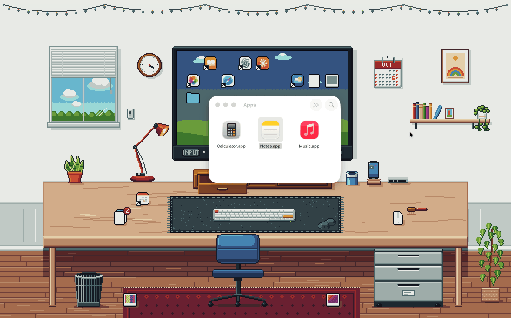<br>
<b>Peek Desk</b><br>
Peek Desk (asomarse a la mesa) hace flotar la mesa sobre tus ventanas un momento.
</td>
</tr>
<tr>
<td colspan="2" valign="top">
<b>Más del sistema</b><br>
Pause Desk · paredes a juego en otras pantallas · se pausa con apps a pantalla completa, en reposo y (si quieres) con batería · un icono en la barra de menús y ninguno en el Dock.<br>
<a href="#ajustes">Ajustes</a>
</td>
</tr>
</table>

## Todo lo que hace

Las tablas de [Dónde se esconde cada cosa](#dónde-se-esconde-cada-cosa) y [Gestos](#gestos), más abajo, muestran cómo
usar cada parte.

### En el monitor

- **Tu Escritorio, en directo.** La carpeta Escritorio (u otra carpeta que elijas) se refleja a medida que cambia: los
  archivos nuevos aparecen imprimiéndose, los renombrados conservan su sitio y los eliminados desaparecen con un ¡puf!
  Los archivos se reconocen por su identidad, así que los renombrados y los guardados atómicos conservan su sitio, y un
  archivo que vuelve antes de 7 días regresa a donde estaba.
- **Iconos reales, en píxeles.** Cada archivo muestra su propio icono del Finder (o, si es una imagen, un vídeo o un
  PDF, una miniatura de Quick Look), pixelado con los colores de la mesa. Hasta que el icono real está listo se ve un
  icono dibujado a mano para su tipo. Los archivos de iCloud que no están descargados siguen así: reciben el icono de su
  tipo y nunca se descargan.
- **Nombres, también en coreano.** Los nombres se dibujan con la fuente pixelada Galmuri9, coreano incluido. Los nombres
  guardados en forma descompuesta (algo habitual con los nombres de archivo coreanos en un Mac) se componen antes (NFC),
  para que el hangul se dibuje entero; los emoji se dibujan en píxeles.
- **Páginas y entradas.** 45 archivos por página (9 × 5), y cada página es una entrada: HDMI 1, 2… se van añadiendo a
  medida que el escritorio se llena. Cambia de página con INPUT, con un desplazamiento con dos dedos sobre la pantalla o
  con el menú Input (que muestra cuántos archivos tiene cada página); deja un archivo que lleves sobre INPUT para pasar
  a la siguiente.
- **AV.** Una entrada que siempre está vacía: otra forma de esconderlo todo, con un logo NO SIGNAL que rebota y se queda
  quieto a los 10 segundos.
- **Encendido.** ⏻ encoge la imagen como un viejo monitor de tubo (CRT) y oculta todas las páginas. Los archivos que
  llegan mientras está apagado encienden un LED ámbar y una insignia «+N».
- **Clean Up By** (ordenar por) Name, Kind o Date Added, desde el menú de clic derecho del monitor.
- **Selección y teclas.** Haz clic, ⌘-clic, arrastra un recuadro sobre la pantalla vacía o pulsa ⌘A; las teclas de
  flecha mueven la selección; la barra espaciadora abre Quick Look, ⌘O abre y ⌘C copia. Arrastra un archivo a otra celda
  (si está ocupada, se intercambian) o lleva varios a la vez.
- **Primer inicio.** Una ventana de bienvenida explica la mesa, y el monitor te pide que pulses ⏻ antes de leer el
  Escritorio; si se denegó el acceso, ofrece Open Settings y Choose Folder… (consulta [Primer inicio](#primer-inicio)).

### Escondites

- **Cajones del elevador** (2). Cada uno admite 8 archivos; a partir de ahí se queda entreabierto (el contenido sigue
  oculto), y con 14 se atasca y hace bonk. Suelta un archivo sobre un cajón cerrado y se lo traga; haz clic en el
  tirador o arrástralo; desplázate sobre él para echar un vistazo; mantén encima un momento un archivo que lleves para
  que se abra solo; ciérralo con fuerza y se cierra de golpe (lo que sacude la mesa).
- **Hueco.** 12 archivos como siluetas tenues, con el nombre al pasar el puntero: solo oculta a medias.
- **Archivador** (3 cajones: 8, 12 y 20 archivos, y se atascan con 6 más). Solo se abre un cajón a la vez; el de abajo
  archiva las cosas bajo pestañas de carpeta con el color de su tipo. Si la silla está delante, el cajón solo se abre
  una rendija y choca con la silla, que se aparta rodando para que el siguiente tirón funcione.
- **Silla.** Arrástrala y rueda; suéltala rápido y sigue deslizándose y girando.
- **Teléfono.** Hasta 6 archivos como iconos de mini apps. Haz clic para ponerlo boca abajo (el contenido se oculta y lo
  que sueltes encima rebota con un bonk); boca arriba, brilla de noche.
- **Portalápices.** Hasta 6 bolígrafos con el capuchón del color de su tipo (el séptimo rebota con un bonk); saca el
  último bolígrafo tirando de él. Arrastra el portalápices por la mesa y aparta los montones a empujones. Arrástralo
  rápido y suéltalo con tres o más bolígrafos dentro (o elige Tip Over) y se vuelca, desparramando los bolígrafos en
  montones; haz clic en él para ponerlo de pie.
- **Cesto de papeles.** Hasta 24 bolas de papel arrugado, amontonadas por encima del borde a partir de la undécima.
  Suelta o lanza archivos dentro (SWISH! si entran limpios, rebotes en el borde, y los que fallan caen al suelo), saca
  la bola de arriba o arrastra el borde hacia un lado para volcarlo (las bolas se desarrugan en el suelo). Nunca borra
  nada: Empty Wastebasket… (vaciar el cesto) mueve el contenido a la Papelera de macOS tras una confirmación que lo
  enumera.
- **Menús.** Los cajones tienen Open Drawer o Close Drawer, y el teléfono Turn Face Up o Turn Face Down; los cajones, el
  hueco y el teléfono tienen List Contents (elige un nombre para enviarlo al monitor), Move Contents to y Take All Out; el portalápices y el cesto
  tienen Tip Over y Stand Up. El Move to ▸ de cualquier archivo lo envía directamente a un escondite.
- **Nada sale solo.** Los golpes, los cierres de golpe y llenar de más nunca vacían un contenedor; si lo llenas de más,
  hace bonk.

### La alfombrilla

- **Tela.** Una alfombrilla de tela simulada, de fieltro por arriba y goma por debajo, con el teclado encima: el teclado
  le da peso y gira con ella.
- **Bajo la alfombrilla.** Los archivos que sueltas encima se deslizan debajo y dejan bultos que crecen con la pila (los
  montones cercanos comparten uno). Todo lo que cubre la tela queda oculto, así que deslizar la alfombrilla sobre
  montones sueltos también los esconde.
- **Levantar y doblar.** Arrastra un borde o una esquina hacia dentro para levantarla: los montones de debajo se ponen
  de pie y puedes llevártelos. Si te detienes un momento antes de soltar, se queda levantada un rato; si tiras más allá
  de la mitad, se queda doblada (haz doble clic en la solapa para desdoblarla).
- **Moverla deja arrugas.** Arrastra la alfombrilla para llevarla; si la mueves rápido deja arrugas que se quedan,
  incluso después de volver a abrir la app. Tira de una esquina hacia fuera, haz doble clic en un borde o elige Smooth
  Desk Mat para alisarlas.
- **Girar y cambiar de tamaño.** Arrastra una esquina con ⌥ para cambiarle el tamaño y girarla (⇧ la ajusta a pasos de
  15°), arrastra el centro con ⌥ para deslizarla sin arrugas, o usa su menú: Rotate (±15°, Straighten), Size (Small,
  Medium, Large), Reset Mat. Solo gira o crece hasta donde cabe en la mesa.
- **Peek Under** levanta un momento la alfombrilla sobre el montón más cercano al clic; en **List Items Under Mat ▸**,
  elegir un nombre devuelve ese archivo al monitor.
- **Modo Flat** (Settings ▸ Desk mat, o Reduce motion): los bultos y el escondite se mantienen, pero la alfombrilla no
  se levanta.
- **Cepillo.** Arrástralo para empujar montones bajo la alfombrilla o fuera del borde de la mesa; un doble clic lo
  devuelve a su sitio. Un desplazamiento lateral con dos dedos sobre la mesa es la escoba de desplazamiento, un cepillo
  invisible.

### Física

- **Montones en la mesa.** Los archivos que dejas en la mesa forman montones (con una etiqueta que indica cuántos hay)
  que se deslizan, chocan y se apilan.
- **Lanzamientos.** Suelta un archivo mientras lo mueves rápido y sale volando en arco: por el borde de la mesa hasta el
  suelo, o dentro del cesto. Los archivos del suelo siguen a la vista y se pueden recoger.
- **Golpe.** Haz doble clic en el borde frontal de la mesa: los montones dan un saltito, el portalápices, el monitor y
  el teléfono se tambalean, la alfombrilla ondea y los cajones entreabiertos se cierran de golpe. Ningún archivo cambia
  de sitio.
- **Clear the Desk.** Una sola acción: el monitor se apaga, el teléfono se da la vuelta, los cajones se cierran y el
  cepillo barre bajo la alfombrilla todos los montones sueltos y los archivos del suelo. «TIDY!» Un solo ⌘Z lo devuelve
  todo a su sitio.
- **Pequeños detalles.** Toca la planta y se menea; haz clic en una tecla y se hunde (nunca muestra lo que tecleas de
  verdad).
- **Reduce motion.** Los lanzamientos aterrizan al instante con una nubecita, nada tiembla y el monitor de tubo se
  desvanece en vez de encogerse.

### Luz

- **Hora del día.** Lights ▸ Auto sigue el reloj por el día, el atardecer y la noche, con el cielo en la ventana (nubes
  que pasan; estrellas y luna de noche). Day, Night y Lamp Only la fijan.
- **Luz de la habitación y lámpara de mesa.** Haz clic en el interruptor de la pared o en la lámpara. La lámpara
  proyecta un círculo de luz cálida sobre la mesa; el monitor y un teléfono boca arriba dan un brillo frío.
- **Lamp Only.** Luz de la habitación apagada y lámpara encendida: solo el círculo de la lámpara y el brillo de las
  pantallas iluminan algo. Los archivos a oscuras son siluetas que no puedes seleccionar, así que la lámpara funciona
  como una linterna.
- **Vista previa del reloj.** Arrastra el minutero del reloj para ver otra hora del día; al soltarlo vuelve a su sitio
  (una vista previa pasada la medianoche cambia la hoja del calendario).

### Archivos y búsqueda

- **Find Item…** (⌘F, buscar un ítem). Cada archivo y dónde está, con búsqueda. Open, Quick Look, Show in Finder, Take
  Out y **Show on Desk**, que abre lo que esconda el archivo (enciende el monitor, cambia de página, abre el cajón,
  aparta la silla, pone el teléfono boca arriba o levanta la alfombrilla) y lo señala.
- **Take Everything Out.** Todos los archivos vuelven al monitor; un solo ⌘Z lo deshace.
- **Órdenes habituales.** Open (doble clic, ⌘O), Quick Look (barra espaciadora), Show in Finder, Copy (⌘C), Open Desktop
  Folder in Finder.
- **Acciones sobre archivos, solo cuando las pides.** Move to Trash (desde el menú; sin atajo de teclado), Empty
  Wastebasket…, soltar archivos desde el Finder (se mueven a la carpeta, o se copian si vienen de otro disco o si usas
  ⌥; una app se convierte en un alias y se queda donde está; si el nombre ya existe, se le añade « 2»), arrastrar
  archivos a otras apps, a Mail o a la Papelera del Dock, y Eject. Los archivos bloqueados nunca se mueven a la carpeta.
- **Deshacer.** ⌘Z deshace los últimos 20 pasos (⌘⇧Z rehace los pasos de disposición), incluidas las propias acciones de
  Deskterior sobre archivos: los archivos enviados a la Papelera vuelven al mismo sitio y los que soltaste vuelven de
  donde vinieron. Expulsar y arrastrar a otras apps no se puede deshacer. Cada acción sobre archivos se anota en
  `operations.log`.
- **Hub de unidades.** Las unidades montadas se enchufan en el hub como memorias USB, discos o servidores (cuatro
  ranuras y luego una etiqueta «+n»). Doble clic para abrir; Open, Show in Finder y Eject desde el menú. Los archivos
  que sueltas sobre una unidad rebotan con un bonk: copiar a unidades es cosa del Finder.
- **La seguridad, lo primero.** Esconder solo cambia la disposición, y nunca se borra ni se sobrescribe nada: consulta
  [Tus archivos están a salvo](#tus-archivos-están-a-salvo).

### Sistema

- **Cubre el Finder sin cambiar nada.** La mesa es una ventana justo por encima de los iconos del escritorio del Finder;
  los ajustes del Finder solo se leen. Sal de Deskterior o usa Pause Desk y vuelves a tener tu escritorio.
- **Icono en la barra de menús y menú de la pared.** No hay icono en el Dock: las órdenes de la mesa están en el icono
  de la barra de menús y en un clic derecho sobre la pared vacía, y cada objeto tiene su propio menú de clic derecho.
- **Todas las pantallas.** El dibujo se amplía en múltiplos enteros (píxeles Chunky, Normal o Fine) y la habitación se
  extiende hasta llenar cualquier pantalla; las pantallas altas y verticales tienen un techo con vigas, una estantería,
  láminas y plantas colgantes. Las demás pantallas pueden tener una pared a juego (los archivos que sueltas en una van
  al monitor), y en Settings se elige la pantalla de la mesa.
- **Peek Desk y Pause Desk.** Peek hace flotar la mesa sobre tus ventanas (× Done o Esc; atajo opcional ⌃⌥⌘D,
  desactivado por omisión). Pause la guarda y muestra el escritorio del Finder hasta que la reanudes.
- **No estorba.** La mesa se pausa bajo apps a pantalla completa, durante el reposo de la pantalla, el bloqueo de
  pantalla y el cambio de usuario, y opcionalmente con batería (una imagen fija hasta que la uses); deja de dibujar
  mientras nada se mueve, y el Modo de bajo consumo la limita a 30 fotogramas por segundo. Desplaza un poco la
  habitación para mantener los widgets del escritorio lejos del monitor y los cajones.
- **Recuerda tu mesa.** La disposición se guarda sobre la marcha, con copias de seguridad cada hora, cada día y cada
  semana; cada carpeta reflejada guarda su propia disposición, y un archivo de disposición dañado se repara o se
  sustituye por una copia de seguridad.
- **[Ajustes](#ajustes) (Settings).** Lights, Reduce motion, Desk mat, Pixel size, Mirrored folder, Peek Desk shortcut,
  Launch at login, Pause on battery, las pantallas, Language, Leftover copies (tras una copia interrumpida), About &
  Credits.
- **[Modo seguro](#modo-seguro).** Mantén pulsada ⌥ al abrir la app para arrancar con normalidad, restablecer la
  disposición (que se guarda como copia de seguridad) o abrir la carpeta de estado.
- **Accesibilidad.** VoiceOver enumera cada archivo y control y lee los mensajes en voz alta; Find Item… llega a todos
  los archivos; Reduce motion (que por omisión sigue al sistema) sustituye las sacudidas, los parpadeos y los vuelos.
- **Idiomas.** Menús, tarjetas, mensajes, ventanas y Settings en inglés y coreano. Language ▸ System elige el primero de
  tus idiomas preferidos que hable Deskterior; con cualquier otro idioma, todo se muestra en inglés.
- **Privacidad.** Ningún acceso a la red, ni analíticas, ni telemetría, ni actualizador. El único permiso que necesita
  es el de tu carpeta Escritorio.
- **Distribución.** Una sola app universal para Apple silicon e Intel en macOS 14 y posteriores, compilada con las
  Command Line Tools (sin Xcode). Las versiones publicadas llevan una firma ad hoc (sin notarizar) y vienen con una suma
  de comprobación SHA-256 y una atestación de procedencia de la compilación; la CI ejecuta más de 1000 pruebas.

## Dónde se esconde cada cosa

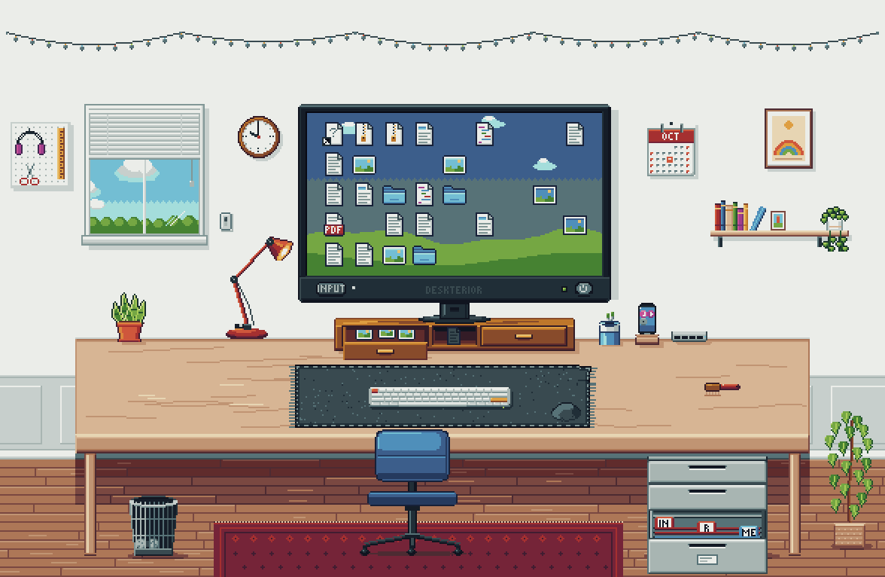

| Lugar | Cómo se esconde | Cómo se recupera |
|---|---|---|
| **Monitor** ⏻ / **INPUT** / **AV** | Pulsa el botón de encendido: la imagen se encoge como en un viejo monitor de tubo y todos los archivos se ocultan. Los archivos que llegan mientras está apagado encienden un LED ámbar y una insignia «+N». INPUT recorre las páginas (HDMI 1, 2…, una por cada 45 archivos) y AV, una página que siempre está vacía. | Vuelve a pulsar el botón de encendido o elige otra entrada. |
| **Cajones del elevador** (2) y **hueco** | Suelta un archivo sobre un cajón cerrado: se abre, se lo queda y se cierra. Un cajón demasiado lleno queda entreabierto; uno atascado no admite más (BONK). El hueco solo oculta a medias: ves siluetas tenues, con el nombre al pasar el puntero. | Haz clic en el tirador, arrástralo o desplázate sobre un cajón cerrado para echar un vistazo. Arrastra los iconos pequeños hacia fuera. |
| **Archivador** (3 cajones) y **silla** | Igual que los cajones del elevador; el cajón de abajo archiva las cosas bajo pestañas de carpeta de colores. Solo se abre un cajón a la vez. | Si la silla estorba, el cajón solo se abre una rendija: la silla se aparta rodando y el siguiente tirón funciona. |
| **Soporte del teléfono** | Suelta archivos sobre el teléfono boca arriba y se convierten en iconos de app. Haz clic en el teléfono para ponerlo boca abajo (un teléfono boca arriba brilla de noche, como uno de verdad). | Vuelve a hacer clic, o elige Turn Face Up en su menú. |
| **Portalápices** | Suelta un archivo dentro y se convierte en un bolígrafo; el color del capuchón indica su tipo. | Saca el último bolígrafo arrastrándolo. Si arrastras rápido el portalápices con tres o más bolígrafos dentro y lo sueltas, se vuelca y los bolígrafos se desparraman por la mesa; haz clic en él para ponerlo de pie. |
| **Cesto de papeles** | Suelta o lanza un archivo dentro. Se arruga, pero **no se borra**: «oculto, no borrado». | Saca la bola de arriba arrastrándola, o arrastra el borde hacia un lado para volcar el cesto. *Empty Wastebasket…* mueve su contenido a la Papelera de macOS tras una confirmación que lo enumera. |
| **Alfombrilla** y **cepillo** | Suelta un archivo sobre la alfombrilla y se desliza debajo dejando un bulto; cuanto más alta la pila, más grande el bulto. Empuja los montones debajo con el cepillo o con un desplazamiento lateral con dos dedos sobre la mesa. | Levanta un borde o una esquina: los montones de debajo se ponen de pie y puedes llevártelos. O clic derecho ▸ Peek Under. Con el modo Flat (o Reduce motion), la alfombrilla no se levanta: clic derecho ▸ List Items Under Mat ▸ un nombre devuelve ese archivo al monitor, y Find Item… (⌘F) también sirve. |
| **Lámpara** y **Lamp Only** | De noche, apaga la luz de la habitación y deja encendida la lámpara de mesa: solo el círculo de la lámpara y el brillo del monitor y del teléfono iluminan algo. Los archivos a oscuras son siluetas: sin nombres ni clics. | Los archivos que quedan dentro del círculo de la lámpara o del brillo del monitor o del teléfono boca arriba aún se pueden seleccionar; vuelve a encender la luz de la habitación o elige Lights ▸ Auto. |
| **Hub de unidades** | Deskterior también tapa los iconos de unidades del Finder, así que las unidades montadas se enchufan en el hub de la mesa. | Doble clic para abrir; Eject desde el menú de la unidad. |
| **Clear the Desk** | Un solo ítem de menú: el monitor se apaga, el teléfono se da la vuelta, los cajones se cierran y el cepillo barre bajo la alfombrilla todos los montones sueltos. «TIDY!» | Un solo ⌘Z lo devuelve todo exactamente como estaba. |
| **Find Item…** (⌘F) | — | Enumera cada archivo y dónde está (con búsqueda). **Show on Desk** abre lo que lo esconda y señala el archivo; **Take Out** lo devuelve al monitor. **Take Everything Out** (en el menú) los devuelve todos. |
| **Peek Desk** / **Pause Desk** | — | Peek Desk levanta la mesa por encima de tus ventanas un momento (× Done o Esc para volver; atajo opcional ⌃⌥⌘D). Pause Desk la guarda y muestra el escritorio del propio Finder hasta que la reanudes. |

Nada sale de su escondite por sí solo. Los golpes, los cierres de golpe y llenar de más nunca vacían un contenedor; un
archivo oculto solo vuelve a verse cuando abres su contenedor, levantas o mueves la alfombrilla, das la vuelta al
teléfono, vuelcas el portalápices o el cesto, cambias de entrada o usas un menú, Find Item…, Show on Desk o Take
Everything Out.

## Gestos

| Gesto | Qué hace |
|---|---|
| **Clic** | Selecciona un archivo (⌘-clic añade o quita uno; arrastra sobre la pantalla vacía para seleccionar varios; ⌘A selecciona la página). También acciona interruptores y pulsa botones: el de encendido, INPUT, la lámpara, el interruptor de la luz de la habitación, el tirador de un cajón, el teléfono. |
| **Doble clic** | Abre un archivo. En el borde frontal de la mesa (el faldón), **da un golpe a la mesa**: las cosas se tambalean, pero ningún archivo cambia de sitio. En el borde de la alfombrilla, la alisa. En una solapa doblada, la desdobla. En el cepillo, lo devuelve a su sitio. |
| **Arrastrar** | Lleva archivos (varios a la vez si hay varios seleccionados) al monitor, a un escondite, a la mesa o al suelo. Si mantienes un momento un archivo sobre un cajón cerrado, se abre. Arrastra el cepillo, la silla (rueda), el portalápices, los tiradores de los cajones y el minutero del reloj (muestra otra hora del día). |
| **Soltar desde el Finder** | Los archivos que arrastras desde el Finder a la mesa caen donde los sueltas: se mueven a tu carpeta Escritorio, o se copian si vienen de otro disco. Una **app** se convierte en un alias (su propio icono con una flecha; doble clic la abre) y se queda donde está; una que sacas de la Papelera o de una imagen de disco entra como cualquier archivo. Mantén pulsada ⌥ para copiar, ⌘ para mover (también las apps) y ⌘⌥ para crear un alias de cualquier cosa. Los archivos que sueltas en otra pantalla van al monitor. |
| **Lanzar** | Suelta un archivo que llevas mientras lo mueves rápido y sale volando: por el borde de la mesa hasta el suelo, o dentro del cesto (SWISH!). Si sueltas el portalápices mientras lo arrastras rápido (con tres o más bolígrafos dentro), se vuelca. |
| **Arrastrar la alfombrilla** | Lleva toda la alfombrilla (y el teclado que tiene encima); si la mueves rápido deja arrugas. |
| **Levantar** | Arrastra un borde o una esquina de la alfombrilla hacia dentro: se levanta y los montones de debajo se ponen de pie para que puedas llevarte uno. Si te detienes un momento antes de soltar, se queda levantada un rato; si tiras más allá de la mitad, se queda doblada. |
| **Estirar** | Arrastra una esquina de la alfombrilla hacia fuera para alisar sus arrugas (o haz doble clic en un borde, o elige Smooth Desk Mat). |
| **⌥ (Opción)** | Sobre la alfombrilla, muestra sus controles: arrastra una esquina con ⌥ para cambiarle el tamaño y girarla (⇧ la ajusta a pasos de 15°); arrastra el centro con ⌥ para deslizarla sin arrugas. |
| **Desplazamiento con dos dedos** | De lado sobre la mesa: la **escoba de desplazamiento** barre los montones bajo la alfombrilla. Sobre la pantalla: cambia de página. Sobre un cajón cerrado: echa un vistazo dentro. |
| **Clic derecho** | Un menú para todo: archivos (Open, Quick Look, Show in Finder, Copy, **Move to ▸** una página del monitor o un cajón, el hueco, el teléfono, el portalápices o el cesto, Move to Trash), el monitor, cada contenedor, la alfombrilla (Peek Under, Smooth, Rotate, Size, List Items Under Mat ▸) y las unidades. Un clic derecho en la pared vacía abre el mismo menú que el icono de la barra de menús. |
| **Teclas** (tras hacer clic en la mesa) | Barra espaciadora: Quick Look · ⌘O / ⌘↓: abrir · flechas: mover la selección · ⌘A · ⌘C: copiar · ⌘F: Find Item… · ⌘Z / ⌘⇧Z: deshacer y rehacer · Esc: cancelar lo que llevas o terminar un vistazo. No hay tecla para borrar. |

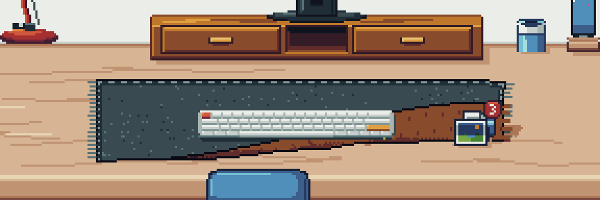

Deskterior no tiene icono en el Dock. Su menú es el pequeño icono de píxeles de la barra de menús, o un clic derecho
sobre la pared vacía (práctico si ocultas ítems de la barra de menús).

## Tus archivos están a salvo

- **Esconder solo cambia la disposición.** Un archivo en un cajón, bajo la alfombrilla o en el cesto sigue en tu carpeta
  Escritorio, intacto. El Finder, Spotlight y todas las demás apps lo ven exactamente igual que antes. Deskterior solo
  recuerda dónde lo pusiste.
- **Los archivos solo cambian cuando lo pides expresamente**, con una de estas acciones:
  - **Move to Trash** desde el menú de clic derecho de un archivo (sin atajo de teclado);
  - **Empty Wastebasket…**, tras una confirmación que enumera los nombres;
  - soltar archivos desde el Finder sobre la mesa (se mueven a tu carpeta Escritorio; se copian si vienen de otro disco
    o si mantienes pulsada ⌥; una app se convierte en un alias y se queda donde está, igual que cualquier cosa con ⌘⌥);
  - arrastrar un archivo a otra app (esa app hace lo mismo que con un arrastre desde el Finder; si lo sueltas en la
    Papelera del Dock, Deskterior lo mueve él mismo a la Papelera si el Dock no lo ha hecho);
  - **Eject** desde el menú de una unidad;
  - **Move to Trash** en Settings ▸ Leftover copies, que solo aparece tras una copia interrumpida (más abajo).
- **A la Papelera, nunca borrar.** Deskterior mueve archivos a la Papelera de macOS y nunca borra nada. Nunca
  sobrescribe un archivo: si un nombre ya existe, se le añade « 2», « 3»…
- **Los archivos bloqueados se quedan donde están.** Un archivo bloqueado que sueltas en la mesa no se mueve a tu
  carpeta Escritorio (mantén pulsada ⌥ para copiarlo en su lugar). Si una copia se interrumpe, por ejemplo al salir de
  la app a mitad de la copia, puede dejar una carpeta oculta `.deskterior-partial-…` en tu carpeta Escritorio (solo
  cuando macOS no ofrece una carpeta temporal en ese disco): Deskterior te avisa una vez en cada arranque mientras siga
  ahí y la muestra en Settings ▸ Leftover copies (Show in Finder, Move to Trash), pero nunca la elimina por su cuenta.
- **Deshacer.** ⌘Z deshace los cambios de disposición y las propias acciones de Deskterior sobre archivos (Move to
  Trash, Empty Wastebasket…, soltar archivos en la mesa): los archivos enviados a la Papelera vuelven al mismo sitio de
  la mesa y los que soltaste vuelven de donde vinieron (las copias y los alias van a la Papelera). Expulsar y arrastrar a otras apps
  no se puede deshacer, salvo un arrastre a la Papelera del Dock que haya completado Deskterior. Si macOS no deja que
  Deskterior llegue a la Papelera, te lo dice y puedes usar Devolver en el Finder.
- **El Finder no se toca.** La mesa es una ventana justo por encima de los iconos del escritorio del Finder: los tapa,
  no los oculta cambiando ningún ajuste del Finder (los ajustes del Finder solo se leen). Sal de Deskterior o usa Pause
  Desk y vuelves a tener tu escritorio normal.
- **Privacidad.** Ningún acceso a la red, ni analíticas, ni telemetría. El único permiso que necesita es el de tu
  carpeta Escritorio (macOS también puede preguntar una vez cuando sueltas archivos desde Descargas, Documentos u otra
  unidad); nada de Accesibilidad, Grabación de pantalla ni Monitorización de entrada. Cada acción sobre archivos se
  anota en `operations.log`, en su carpeta de estado.

## Instalación

Deskterior es gratis y Apple no lo ha notarizado (para eso hace falta una cuenta de desarrollador de pago). La versión
publicada tiene una firma ad hoc, así que macOS bloquea una vez el primer arranque de cada versión descargada. Es lo
esperado.

1. Descarga **Deskterior-*versión*.zip** de la [última versión](../../releases/latest) y haz doble clic en él para
   descomprimirlo.
2. **Primero mueve `Deskterior.app` a tu carpeta Aplicaciones.** Si la abres directamente desde Descargas, macOS la
   ejecuta desde una copia oculta de solo lectura (App Translocation), donde puede olvidar sus permisos; Deskterior lo
   detecta y te pide que la muevas.
3. Abre Deskterior.
   - **macOS 15 Sequoia y posteriores:** macOS muestra *No se ha abierto “Deskterior”*. Haz clic en **OK** (no en
     Trasladar a la Papelera). Abre **Ajustes del Sistema ▸ Privacidad y seguridad**, desplázate hasta **Seguridad** y
     haz clic en **Abrir igualmente** junto al mensaje sobre Deskterior (se queda ahí más o menos una hora); después
     confirma con **Abrir igualmente** y tu contraseña o Touch ID. Control + clic ▸ Abrir ya no se salta este paso.
   - **macOS 14 Sonoma:** haz Control + clic (o clic derecho) en la app, elige **Abrir** y luego otra vez **Abrir**. El
     botón Abrir igualmente de Privacidad y seguridad también funciona.
4. Repite esto después de cada actualización. Como la compilación tiene una firma ad hoc, macOS también puede volver a
   pedir acceso a la carpeta Escritorio tras una actualización.

Para comprobar una descarga, abre Terminal en la carpeta donde descargaste los dos archivos (normalmente:
`cd ~/Downloads`) y compárala con el archivo `.sha256` de la misma versión, o verifica que el flujo de trabajo de
publicación la compiló a partir de este repositorio (con GitHub CLI; sustituye OWNER por la cuenta que aparece en la URL
de esta página):

```sh
shasum -a 256 -c Deskterior-0.2.0.zip.sha256
gh attestation verify Deskterior-0.2.0.zip --repo OWNER/deskterior
```

## Primer inicio

1. Una ventana de bienvenida explica la mesa. El monitor muestra **PRESS ⏻ TO CONNECT DESKTOP**.
2. Haz clic en el botón de encendido ⏻ del monitor. macOS pregunta si Deskterior puede acceder a los archivos de tu
   carpeta Escritorio: haz clic en **Permitir**. Tus archivos aparecen en el monitor. Deskterior solo lo pide después de
   que pulses ⏻.
3. Si hiciste clic en **No permitir**, el monitor muestra **NO SIGNAL** con dos botones: **Open Settings** (Ajustes del
   Sistema ▸ Privacidad y seguridad ▸ Archivos y carpetas, donde puedes activar Carpeta Escritorio para Deskterior) y
   **Choose Folder…** (elige tu carpeta Escritorio; al elegirla le das acceso).
4. Si el Finder está configurado para no mostrar ítems en el escritorio, el monitor pregunta primero **Show them on the
   desk anyway?** (Show / Keep Hidden: mostrarlos en la mesa o seguir ocultándolos).
5. Con más de una pantalla, la ventana de bienvenida pregunta si quieres cubrir las demás pantallas con una pared a
   juego. Los archivos que sueltes en una pared van al monitor.

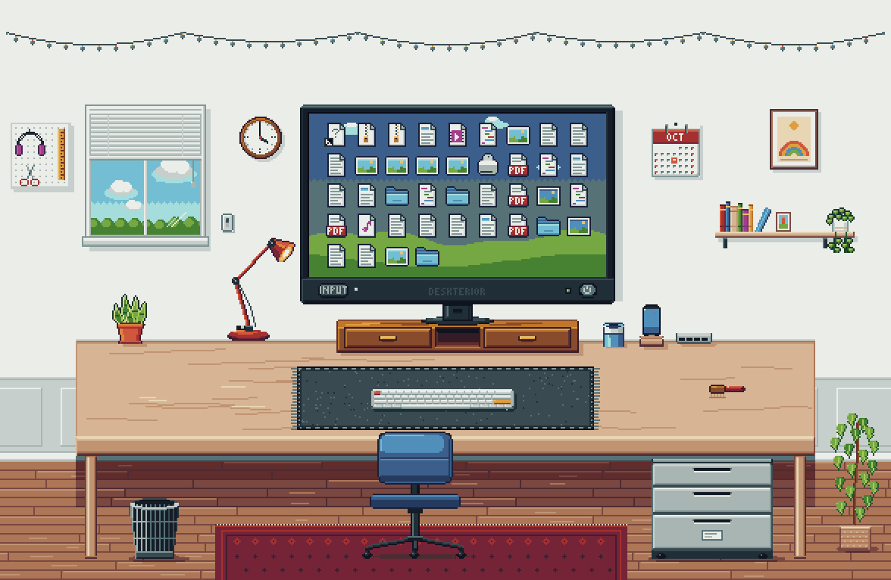

## Ajustes

Icono de la barra de menús ▸ **Settings…**

| Ajuste | Opciones | Predeterminado |
|---|---|---|
| Lights | Auto (sigue la hora del día), Day, Night, Lamp Only | Auto |
| Reduce motion | Follow System, Always, Never: sin sacudidas ni parpadeos, el monitor de tubo se desvanece en vez de encogerse, la alfombrilla queda plana, los archivos lanzados aterrizan sin volar y el logo de AV se queda quieto | Follow System |
| Desk mat | Cloth (se levanta, se dobla y se arruga) o Flat (solo bultos) | Cloth |
| Pixel size | Chunky, Normal, Fine | Normal |
| Mirrored folder | Tu Escritorio u otra carpeta (Choose Folder… / Use Desktop) | Escritorio |
| Peek Desk shortcut ⌃⌥⌘D | Activado / desactivado (no necesita el permiso de Accesibilidad) | **Desactivado** |
| Launch at login | Activado / desactivado | **Desactivado** |
| Pause the desk on battery power | Activado / desactivado (una imagen fija hasta que la uses) | Desactivado |
| Desk display, Cover other displays with a wall | Aparecen cuando hay más de una pantalla | Menu bar display |
| Language | System, English, 한국어 | System |

Si la carpeta elegida no está al arrancar (porque se renombró, se eliminó o está en una unidad que aún no se ha
montado), la mesa muestra tu Escritorio durante esa sesión y Settings lo indica; la elección se conserva para el
siguiente arranque.

Settings ▸ **About & Credits…** muestra la versión y los créditos.

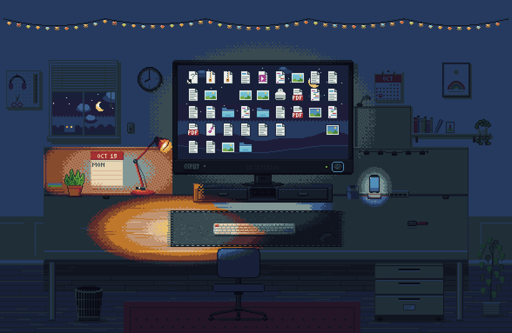

## Modo seguro

Mantén pulsada la tecla **⌥ (Opción)** mientras Deskterior arranca. Aparece la ventana de modo seguro (Deskterior Safe
Mode) antes que la mesa, y todavía no se ha tocado nada:

- **Start Normally** (arrancar con normalidad);
- **Reset Layout…**: todos los archivos vuelven al monitor; la disposición anterior se guarda como copia de seguridad en
  la carpeta de estado (no se borra ningún archivo);
- **Open State Folder** (abrir la carpeta de estado);
- **Quit**.

Si la mesa deja de responder alguna vez, `killall Deskterior` en Terminal la quita al instante y vuelve tu escritorio
normal; tus archivos nunca se tocaron.

## Desinstalar

1. Si activaste **Launch at login**, desactívalo en Settings.
2. Sal de Deskterior (icono de la barra de menús ▸ Quit Deskterior).
3. Si quieres, elimina también su disposición, la caché de iconos, los ajustes y los permisos de privacidad. Llevan el
   nombre del identificador de paquete (bundle identifier) de la app, así que léelo antes de borrar la app. Pega todo el
   bloque en Terminal de una vez:

   ```sh
   ID="$(defaults read /Applications/Deskterior.app/Contents/Info CFBundleIdentifier)" &&
   case "$ID" in io.github.*.deskterior | io.github.deskterior.dev)
     rm -rf ~/Library/Application\ Support/"$ID" ~/Library/Caches/"$ID"
     defaults delete "$ID"
     tccutil reset All "$ID"
   esac
   ```

   Si la primera línea muestra un error, detente: Deskterior no está en /Applications. El bloque elimina la disposición,
   sus copias de seguridad y `operations.log` (Application Support), la caché de iconos (Caches), los ajustes
   (`defaults`) y el permiso de la carpeta Escritorio (`tccutil`), y no hace nada si el identificador no es el de
   Deskterior.

4. Mueve `Deskterior.app` a la Papelera.

## Compilar desde el código fuente

Necesitas macOS 15.6 o posterior con las Command Line Tools para Xcode 26 (Swift 6.2; `xcode-select --install`). No hace
falta Xcode. La app que compiles funciona en macOS 14 y posteriores. Después, en un clon de este repositorio:

| Comando | Qué hace |
|---|---|
| `make build` | `swift build` |
| `make test` | las suites de pruebas (`scripts/swift-test.sh`) |
| `make lint` | el lint de seguridad de archivos (`scripts/check-file-safety.sh`) |
| `make app` | `build/Deskterior.app` para el procesador de este Mac, con firma ad hoc (`VERSION=0.2.0` fija la versión) |
| `make universal` | lo mismo para Apple silicon e Intel en una sola app |
| `make install` | `make app` y luego copia la app a /Applications |
| `make run` | ejecuta la mesa en una ventana sobre una carpeta temporal nueva con archivos de ejemplo |
| `make gif` | graba `Demos/hero.json` y regenera `docs/media` (necesita ffmpeg) |

Una app que compilas tú no está en cuarentena, así que Gatekeeper no la detiene. El identificador de paquete sale del
remoto de GitHub de tu clon (`io.github.OWNER.deskterior`, como en la versión publicada); sin remoto, es el
identificador de desarrollo `io.github.deskterior.dev`. Firmar con un certificado autofirmado gratuito conserva el
permiso del Escritorio entre compilaciones: consulta [docs/SIGNING.md](docs/SIGNING.md).

Las ejecuciones de desarrollo nunca tocan tu Escritorio real: necesitan una carpeta temporal, y la app rechaza (con el
código de salida 64) el Escritorio real o cualquier cosa que haya dentro. Las demos con guion se ejecutan sin interfaz
sobre una carpeta de prueba nueva y escriben PNG (esta, en `.build/demo-out/10-clear-desk`); las dos últimas líneas son
lo que hace `make run`:

```sh
scripts/run-demo.sh 10-clear-desk
FIX="$(mktemp -d)"; scripts/make-fixture-desktop.sh "$FIX/desk"
swift run Deskterior --windowed --desktop-folder "$FIX/desk" --state-dir "$FIX/state"
```

Más: [docs/DESIGN.md](docs/DESIGN.md) (el diseño), [docs/DEMOS.md](docs/DEMOS.md) (los guiones de las demos),
[docs/SPIKES.md](docs/SPIKES.md) (comprobaciones de la plataforma), [CHANGELOG.md](CHANGELOG.md).

## Requisitos

- macOS 14 Sonoma o posterior.
- Un Mac con Apple silicon o Intel (una sola app universal).
- Permiso para leer tu carpeta Escritorio (se pide la primera vez que pulsas ⏻).

## Limitaciones conocidas

- **Sin notarizar.** Cada versión descargada necesita el paso de Abrir igualmente descrito arriba, y tras una
  actualización macOS puede volver a pedir acceso al Escritorio (la firma ad hoc cambia con cada compilación).
- **Probado en un solo Mac** (un MacBook Air M2 con macOS 26). Deskterior también se compila para macOS 14 y 15, pero
  nunca se ha ejecutado en ellos, y la mitad Intel de la app no se ha ejecutado en un Mac con Intel.
- **Parte del comportamiento de la plataforma necesita una comprobación humana** que la automatización no puede hacer:
  clics y el paso del puntero con otra app en primer plano, Quick Look y ⌘Z después de hacer clic en la mesa, la pausa
  bajo apps a pantalla completa, arrastrar hacia el Finder, Mail y la Papelera del Dock, deshacer un envío a la Papelera
  a través de la Papelera real y soltar archivos desde Descargas. Consulta [docs/SPIKES.md](docs/SPIKES.md).
- Hacer clic en el fondo de pantalla para mostrar el escritorio (macOS 14 y posteriores) no funciona sobre la mesa; usa
  Mostrar escritorio, Peek Desk o Pause Desk.
- Los widgets del escritorio quedan por encima de la mesa; cuando puede, Deskterior desplaza un poco la habitación para
  mantenerlos lejos del monitor y los cajones.
- En los modos de pantalla escalados, los píxeles se ven algo suaves.
- Una carpeta reflejada en una unidad **exFAT** no admite que se suelten archivos en ella, y ⌘Z no puede devolverle
  archivos enviados a la Papelera: exFAT no admite el renombrado sin sobrescritura que Deskterior usa en cada
  movimiento, así que lo rechaza y no cambia nada. FAT32 y APFS funcionan.
- El escritorio del propio Finder sigue ahí debajo. Si el Finder tenía iconos seleccionados en el escritorio antes de
  que Deskterior lo cubriera, ⌘⌫ en el Finder todavía puede moverlos a la Papelera (Deshacer en el Finder los devuelve).
- Algunas partes de la escena siguen en inglés en la v0.1, también con el idioma coreano: sus textos de ayuda, los
  nombres que VoiceOver da a los objetos de la mesa, el logo NO SIGNAL de la entrada AV, BONK, SWISH! y TIDY!

## Créditos

- Fuente: [Galmuri9](https://github.com/quiple/galmuri) de Lee Minseo (quiple), con licencia SIL Open Font License 1.1,
  incluida sin modificar junto con su licencia.
- Paleta: [Apollo](https://lospec.com/palette-list/apollo) de AdamCYounis. Cada píxel de la mesa es uno de sus 46
  colores.
- Deskterior es un proyecto independiente inspirado en el prototipo de alfombra para el escritorio de Terkel Gjervig,
  *Desktop Cleaning* (desktop.cleaning). No está afiliado a él ni a GitHub, no cuenta con el respaldo de ninguno de los
  dos y no usa nada del código, el nombre, el arte ni la marca de ese prototipo.

## Licencia

El código tiene licencia MIT: consulta [LICENSE](LICENSE). El material de terceros incluido conserva su propia licencia:
consulta [THIRD_PARTY_NOTICES.md](THIRD_PARTY_NOTICES.md).
