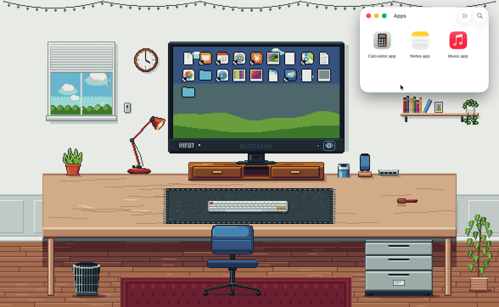
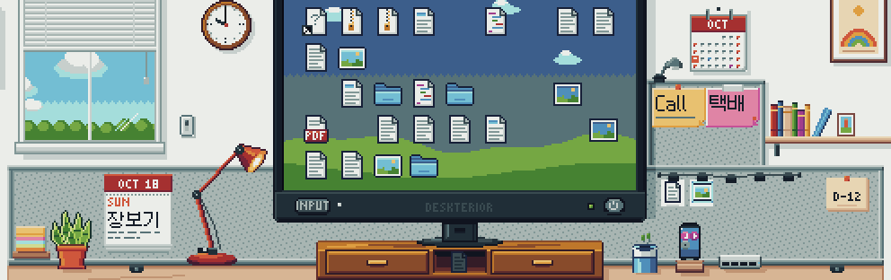

[English](README.md) · [한국어](README.ko.md) · **简体中文** · [日本語](README.ja.md) · [Español](README.es.md)

<div align="center">


# Deskterior

像收拾真实的书桌一样，用像素风整理你的 Mac 桌面。

[](../../releases/latest)
[](../../actions/workflows/ci.yml)
[](#系统要求)
[](LICENSE)



<sub>上图是这款应用在 Mac 上的真实录屏。下方的静态图片用的是书桌内置的文件图标；在你的 Mac 上，每个文件都会以像素形式显示它自己的图标或缩略图。</sub>

</div>

**一张住在 Mac 桌面上的像素风书桌**。Deskterior 在桌面上铺开一个亮着灯的小房间，“桌面”文件夹里的文件会以图标的形式出现在书桌的显示器上。像收拾真实的书桌那样把它们收起来：放进显示器增高架的抽屉或文件柜，放到手机支架上或插进笔筒里，扔进垃圾桶，用刷子扫到布桌垫底下，或者干脆按下显示器的电源键。隐藏只改变布局。你的文件留在原处，只有在你明确要求时才会改变。

Deskterior 的界面只有英文和韩文两种语言，会按你 Mac 的语言设置在两者之间选择（其他语言一律显示英文），所以下文中的菜单、按钮等界面名称都保留英文原文。

[**下载最新版本**](../../releases/latest) · macOS 14 Sonoma 或更高版本 · Apple 芯片与 Intel · 免费开源（MIT）

- [功能](#功能) · [全部功能](#全部功能) · [东西藏在哪里](#东西藏在哪里) · [操作手势](#操作手势) · [你的文件很安全](#你的文件很安全)
- [安装](#安装) · [首次运行](#首次运行) · [设置](#设置) · [安全模式](#安全模式) · [卸载](#卸载)
- [从源代码构建](#从源代码构建) · [系统要求](#系统要求) · [已知限制](#已知限制) · [致谢](#致谢) · [许可证](#许可证)

## 功能

这里的每段动图都是 Deskterior 在 Mac 上的真实录屏。完整列表见[全部功能](#全部功能)。

### 显示器上

<table>
<tr>
<td valign="top">

</td>
<td valign="top">
<b>真实图标，像素呈现</b><br>
把应用或文件从访达拖到显示器上：它们的真实图标会变成像素图标。
</td>
</tr>
<tr>
<td valign="top">

</td>
<td valign="top">
<b>CRT 电源键</b><br>
⏻ 让画面像老式 CRT 一样收缩消失，所有文件随之隐藏。关机期间有文件到来，会亮起琥珀色的 +1 角标。
</td>
</tr>
<tr>
<td valign="top">

</td>
<td valign="top">
<b>INPUT 与 AV</b><br>
INPUT 在 HDMI 页之间切换，每页 45 个文件。AV 永远是空的：NO SIGNAL。
</td>
</tr>
<tr>
<td colspan="2" valign="top">
<b>显示器上的其他功能</b><br>
Clean Up By（整理方式）按名称、种类或添加日期 · 点击、按住 ⌘ 点击、拖出选框或 ⌘A 选择 · 方向键；空格键快速查看 · 在屏幕上滚动即可翻页。<br>
<a href="#全部功能">全部功能</a>
</td>
</tr>
</table>

### 藏身处

<table>
<tr>
<td valign="top">

</td>
<td valign="top">
<b>增高架抽屉与置物格</b><br>
把文件放到关着的抽屉上，它会一口吞下。在抽屉上滚动可以偷看；置物格只藏一半。
</td>
</tr>
<tr>
<td valign="top">

</td>
<td valign="top">
<b>文件柜与椅子</b><br>
椅子挡住了文件柜：把它推开，再拉一次。最下层抽屉会把文件归到文件夹标签下。
</td>
</tr>
<tr>
<td valign="top">

</td>
<td valign="top">
<b>手机支架</b><br>
文件会变成手机上的迷你应用。把手机屏幕朝下扣过去，它们就藏起来了。
</td>
</tr>
<tr>
<td valign="top">

</td>
<td valign="top">
<b>笔筒</b><br>
文件变成笔，笔帽颜色代表文件种类。甩一下笔筒，它就会倒下，把笔撒出来。
</td>
</tr>
<tr>
<td valign="top">

</td>
<td valign="top">
<b>垃圾桶</b><br>
把文件扔进去：SWISH! 可以把垃圾桶碰倒，再扶起来。只是藏起来，并没有删除。
</td>
</tr>
<tr>
<td colspan="2" valign="top">
<b>藏身处的其他功能</b><br>
抽屉、置物格和手机可以在各自的菜单里列出内容、移走内容或全部取出 · 能看出装了多满（太满的抽屉会微微敞开，再多就卡住） · 不会有东西自己跑出来。<br>
<a href="#东西藏在哪里">东西藏在哪里</a>
</td>
</tr>
</table>

### 桌面隔板

<table>
<tr>
<td colspan="2" valign="top">
<br>
<b>便利贴、每日便签和日历</b><br>
从便利贴方块上撕下一张，贴在毛毡隔板上的任意位置；在每日便签上写下今天的备忘；在墙上的日历里看到有备忘的日子。
</td>
</tr>
<tr>
<td colspan="2" valign="top">
<b>隔板上的其他功能</b><br>
备忘夹最多夹 5 个文件 · D-Day 倒计时卡 · 夜里用的夹灯 · Save as Text File on Desktop（在桌面存为文本文件） · 不用的东西可以 Put Away（收起来）。<br>
<a href="#全部功能">全部功能</a>
</td>
</tr>
</table>

### 桌垫

<table>
<tr>
<td valign="top">

</td>
<td valign="top">
<b>扫到垫子底下</b><br>
把文件放到桌垫上：它们会滑进底下，留下鼓包。掀起边缘就能取出一个。
</td>
</tr>
<tr>
<td colspan="2" valign="top">
<br>
<b>一块真正的布</b><br>
搬动它会起皱。按住 ⌥ 拖动可以旋转或调整大小（上面的键盘跟着一起转），还能对折，拽一拽就平了。
</td>
</tr>
<tr>
<td valign="top">

</td>
<td valign="top">
<b>刷子与滚动扫帚</b><br>
用刷子把文件堆推到垫子底下，或者在书桌上用两指横向滚动。
</td>
</tr>
<tr>
<td colspan="2" valign="top">
<b>桌垫的其他功能</b><br>
Peek Under · List Items Under Mat · Rotate、Size、Smooth、Reset Mat · Flat（平铺）模式保留鼓包，但桌垫不会掀起。<br>
<a href="#操作手势">操作手势</a>
</td>
</tr>
</table>

### 物理效果

<table>
<tr>
<td valign="top">

</td>
<td valign="top">
<b>文件堆、地板与敲桌子</b><br>
放在桌面上的文件会堆起来。可以把一个甩到地板上；双击书桌前沿就能敲一下桌子。
</td>
</tr>
<tr>
<td colspan="2" valign="top">
<br>
<b>Clear the Desk（一键清桌）</b><br>
一个菜单项就能把所有东西藏起来：TIDY! 按一次 ⌘Z 全部复原。
</td>
</tr>
</table>

### 灯光

<table>
<tr>
<td colspan="2" valign="top">
<br>
<b>Night 与 Lamp Only</b><br>
把灯光设为 Night（夜晚），拨动房间开关进入 Lamp Only（只开台灯），再点一下台灯。
</td>
</tr>
<tr>
<td colspan="2" valign="top">
<b>灯光的其他功能</b><br>
Auto 跟随时钟在白天、黄昏和夜晚之间变化 · 拖动时钟的分针预览其他时刻 · 在 Lamp Only 下，黑暗中的文件只是剪影，无法选取。<br>
<a href="#全部功能">全部功能</a>
</td>
</tr>
</table>

### 文件与查找

<table>
<tr>
<td colspan="2" valign="top">
<br>
<b>Find Item…（查找项目）</b><br>
⌘F 列出每个文件以及它藏在哪里。Show on Desk 会打开藏身处，把文件指给你看。
</td>
</tr>
<tr>
<td valign="top">

</td>
<td valign="top">
<b>Move to Trash，再撤销回来</b><br>
Move to Trash（移到废纸篓）把文件移到 macOS 废纸篓；⌘Z 把它放回原来的位置。
</td>
</tr>
<tr>
<td valign="top">

</td>
<td valign="top">
<b>驱动器集线器</b><br>
U 盘会插在书桌上的集线器里。从它的菜单里选 Eject 即可推出。
</td>
</tr>
<tr>
<td colspan="2" valign="top">
<b>文件的其他功能</b><br>
从访达拖入文件 · 把文件拖出到其他应用 · Empty Wastebasket… 会先列出文件名 · 每个操作都有日志记录。<br>
<a href="#你的文件很安全">你的文件很安全</a>
</td>
</tr>
</table>

### 系统

<table>
<tr>
<td colspan="2" valign="top">
<br>
<b>Peek Desk（偷看书桌）</b><br>
Peek Desk 让书桌暂时浮在你的窗口上方。
</td>
</tr>
<tr>
<td colspan="2" valign="top">
<b>系统方面的其他功能</b><br>
Pause Desk · 其他显示器可铺上配套的墙 · 全屏应用、睡眠时（以及可选的电池供电时）自动暂停 · 只有菜单栏图标，没有程序坞图标。<br>
<a href="#设置">设置</a>
</td>
</tr>
</table>

## 全部功能

下方的[东西藏在哪里](#东西藏在哪里)和[操作手势](#操作手势)两张表介绍了每个部分的用法。

### 显示器上

- **实时同步你的桌面**。“桌面”文件夹（或你选择的其他文件夹）的变化会实时映射过来：新文件像打印一样出现，改了名的文件保持原位，被移走的文件“噗”地消失。文件按身份而不是按名称识别，所以改名和安全保存之后位置不变；7 天内回来的文件会回到原来的位置。
- **真实图标，像素呈现**。每个文件都显示它自己的访达图标，图片、视频和 PDF 则显示快速查看缩略图，并像素化为书桌的配色。真实图标准备好之前，先显示按种类手绘的图标。尚未下载的 iCloud 文件保持原样：显示种类图标，绝不会被下载。
- **文件名也支持韩文**。文件名用 Galmuri9 像素字体绘制，韩文也包括在内。以分解形式存储的文件名（在 Mac 上的韩文文件名中很常见）会先组合（NFC），让韩文完整显示；emoji 也以像素绘制。
- **分页与输入源**。每页 45 个文件（9 × 5），每页对应一个输入源：随着桌面文件增多，依次添加 HDMI 1、2……。用 INPUT、在屏幕上两指滚动或 Input 菜单（会显示每页的文件数）翻页；把正在拖动的文件停在 INPUT 上，会切换到下一页。
- **AV**。一个永远为空的输入源：这是隐藏所有文件的另一种方式，屏幕上有一个四处弹跳的 NO SIGNAL 标志，10 秒后停下。
- **电源**。⏻ 让画面像老式 CRT 一样收缩消失，所有页面都会隐藏。关机期间到来的文件会点亮一颗琥珀色 LED 和一个“+N”角标。
- **Clean Up By**（整理方式）：在显示器的右键菜单里按名称（Name）、种类（Kind）或添加日期（Date Added）整理。
- **选择与按键**。点击、按住 ⌘ 点击、在空白屏幕上拖出选框或按 ⌘A；方向键移动选择；空格键打开快速查看，⌘O 打开，⌘C 拷贝。把文件拖到另一个格子（格子已被占用时两者互换），也可以一次搬动多个。
- **首次运行**。欢迎窗口会介绍这张书桌，显示器会请你先按下 ⏻，然后才读取桌面；如果访问被拒绝，它会提供 Open Settings 和 Choose Folder…（见[首次运行](#首次运行)）。

### 藏身处

- **增高架抽屉**（2 个）。每个装 8 个文件；超过之后它会微微敞开（里面的东西仍然藏着），到 14 个就卡住，再放会被弹回（BONK）。把文件放到关着的抽屉上，它会一口吞下；点击或拖动把手；在上面滚动可以偷看；拖着文件在上面悬停，抽屉会弹开；用力关上会“砰”的一声（这一下相当于敲了一下书桌）。
- **置物格**。12 个文件以暗淡的剪影显示，悬停时显示名称：它只藏一半。
- **文件柜**（3 个抽屉：分别装 8、12 和 20 个文件，再多 6 个就卡住）。一次只能打开一个抽屉；最下层会把文件按种类归入不同颜色的文件夹标签下。如果椅子挡在前面，抽屉只能拉开一条缝并撞到椅子，椅子被撞开滚到一旁，下次再拉就能打开。
- **椅子**。拖动它会滚动；快速松手，它会继续滑行并打转。
- **手机**。最多放 6 个文件，显示为迷你应用图标。点击可把它屏幕朝下扣过去（内容隐藏，再往上放会 BONK）；屏幕朝上时，夜里会发光。
- **笔筒**。最多 6 支笔，笔帽颜色代表文件种类（第 7 支会 BONK）；可以把最后一支笔拔出来。在桌上拖动笔筒，它会把文件堆推开。里面有三支或以上的笔时甩一下（或选择 Tip Over），它就会倒下，笔撒成一堆堆；点击可把它扶起来。
- **垃圾桶**。最多 24 个纸团，从第 11 个起会堆得高出桶沿。把文件放进去或扔进去（空心入桶时 SWISH!，碰到桶沿会弹开，没扔准就落到地板上），可以把最上面的纸团掏出来，也可以横向拖动桶沿把它碰倒（纸团会展开，散落在地板上）。它从不删除：Empty Wastebasket…（清空垃圾桶）会先列出内容请你确认，然后才把它们移到 macOS 废纸篓。
- **菜单**。抽屉有 Open Drawer 或 Close Drawer，手机有 Turn Face Up 或 Turn Face Down；抽屉、置物格和手机都有 List Contents（选择一个名称即可把它送回显示器）、Move Contents to 和 Take All Out；笔筒和垃圾桶有 Tip Over 和 Stand Up。任何文件的 Move to ▸ 都能把它直接送到某个藏身处。
- **不会有东西自己跑出来**。敲桌子、砰地关抽屉、塞得太满，都不会让容器清空；塞得太满只会 BONK。

### 收起来

- **Put Away**（收起来）。把用不到的东西收起来：增高架抽屉（增高架留作普通的显示器底座）、文件柜、手机支架、盆栽、桌面隔板或它的任意配件，以及墙架、洞洞板、串灯、落地盆栽和墙面装饰。右键点击它 ▸ Put Away（比如 Put Away Plant），或使用菜单栏菜单里的 Put Away ▸，或在 Arrange Desk…（整理桌面）里一并管理所有东西。
- **里面不留东西**。装着文件的地方会先在菜单里说明（“Take Out 3 & Put Away Cabinet”），先把文件放回显示器再收起来，而且是同一步撤销。
- **Bring Back**（放回来）。用 Bring Back ▸ 逐个放回，或用 Bring Everything Back 一次全部放回；挡在原位上的东西会被挪开。两者都能用 ⌘Z 撤销。

### 桌面隔板

- **隔板**。沿书桌后沿立起的毛毡隔板，显示器旁边高出一截。它也能像别的东西一样收起来，便利贴会等它回来。
- **便利贴**。点击便利贴方块新建一张，或从上面拖出一张；把便利贴拖到毛毡上的任意位置，它会自动对齐到看得清的地方。点击便利贴就会在 Memos（备忘）窗口里编辑它（中文、韩文输入法照常可用）；可以选六种颜色、设定日期、Bring to Front（置于最前），拖进垃圾桶即可撕掉（⌘Z 恢复）。最多 24 张；悬停即可阅读（黑暗中只有被光照到的才行）。
- **每日便签**。台灯下写着今天日期的一页。点击即可书写；把这一页拖下来，就撕成一张标着当天日期的便利贴。
- **墙上日历**。有备忘、带日期的便利贴或 D-Day 的日子会被标记；点击某一天即可打开它。Memos 窗口显示整月。
- **备忘夹**。把最多 5 个文件放到隔板上，它们会像卡片一样夹起来。和所有藏身处一样，这只改变布局。
- **D-Day 卡和夹灯**。在 Memos 窗口的日历里设定 D-Day（卡片上显示“D-12”“D-DAY”“D+3”）；点击夹灯，夜里就能照亮隔板右侧。
- **存为文本文件**。便利贴菜单里的 Save as Text File on Desktop（每日便签菜单里是 Save Today's Memo as Text File），或 Memos 窗口里的按钮，会在你的“桌面”文件夹里新建一个 .txt 文件，并把它夹在隔板上。
- **安全保存**。备忘单独存在状态文件夹的 `memos.json` 里，安全模式的 Reset Layout 和切换文件夹都不会让它们丢失。

### 桌垫

- **布料**。一块模拟的布桌垫，正面是毛毡，背面是橡胶，上面放着键盘：键盘把它压住，并跟着它一起转动。
- **桌垫底下**。放到桌垫上的文件会滑到底下，留下鼓包，堆得越高鼓包越大（挨得近的文件堆共用一个鼓包）。布盖住的东西都会被隐藏，所以把桌垫拖到散落的文件堆上，也能把它们藏起来。
- **掀起与折叠**。把边缘或角往里拖就能掀起：下面的文件堆会立起来，可以拿走。松手前停住不动，它会保持掀起一小会儿；拉过中线，它就保持折叠（双击折起的部分可以展开）。
- **搬动与褶皱**。拖动桌垫即可搬动；搬得快会留下褶皱，而且褶皱会一直保留，重新启动后也还在。把角往外拽、双击边缘，或选择 Smooth Desk Mat，就能把褶皱抚平。
- **旋转与调整大小**。按住 ⌥ 拖动角落可以调整大小并旋转（按住 ⇧ 以 15° 为步进），按住 ⌥ 拖动中间可以平移且不起皱；也可以用它的菜单：Rotate（±15°、Straighten）、Size（Small、Medium、Large）、Reset Mat。它只会在书桌放得下的范围内旋转或变大。
- **Peek Under**（掀开看看）会把离点击处最近的那个文件堆上方的桌垫暂时翻开；**List Items Under Mat ▸** 选一个名称，就会把那个文件放回显示器。
- **Flat 模式**（Settings ▸ Desk mat，或开启 Reduce motion）：鼓包和隐藏都保留，但桌垫不会掀起。
- **刷子**。拖动它可以把文件堆推到桌垫底下，或推出桌边；双击让它回到原位。在书桌上两指横向滚动就是“滚动扫帚”，一把看不见的刷子。

### 物理效果

- **桌面文件堆**。放在书桌上的文件会形成文件堆（带数量标签），会滑动、碰撞、叠起来。
- **甩出去**。快速移动时松开文件，它会沿弧线飞出去：飞出桌边落到地板上，或者落进垃圾桶。地板上的文件仍然可见，也可以捡起来。
- **敲桌子**。双击书桌前沿：文件堆会跳一下，笔筒、显示器和手机会晃动，桌垫泛起波纹，半开的抽屉会啪地合上。没有任何文件改变位置。
- **Clear the Desk**（一键清桌）。一个操作：显示器关闭，手机扣下，抽屉关上，刷子把所有散落的文件堆和地板上的文件都扫到桌垫底下。“TIDY!” 按一次 ⌘Z 就全部复原。
- **小细节**。戳一下植物，它会抖动；点一下键盘上的键，它会按下去（它绝不会显示你真实的输入）。
- **Reduce motion**（减弱动态效果）。扔出的文件会“噗”地一下直接落地，什么都不会晃动，CRT 会淡出而不是收缩。

### 灯光

- **一天中的时间**。Lights ▸ Auto 跟随时钟在白天、黄昏和夜晚之间变化，窗外的天空也随之变化（飘动的云；夜里有星星和月亮）。Day、Night 和 Lamp Only 会把光照固定下来。
- **房间灯与台灯**。点击墙上的开关或台灯。台灯在桌面上投下一片暖光；显示器和屏幕朝上的手机发出冷色的光。
- **Lamp Only**（只开台灯）。关掉房间灯、打开台灯：只有台灯的光晕和屏幕的光能照亮东西。黑暗中的文件只是无法选取的剪影，所以台灯就像手电筒一样。
- **时钟预览**。拖动时钟的分针，看看一天中其他时刻的样子；松手后它会弹回（预览到午夜之后，日历也会翻页）。

### 文件与查找

- **Find Item…**（⌘F）。列出每个文件和它所在的位置，可以搜索。提供 Open、Quick Look、Show in Finder、Take Out，以及 **Show on Desk**（在书桌上显示）：它会打开藏着文件的东西（打开显示器电源、切换页面、拉开抽屉、把椅子挪开、把手机翻过来，或掀开桌垫看看底下），并把文件指给你看。
- **Take Everything Out**（全部取出）。所有文件都回到显示器上；按一次 ⌘Z 即可撤销。
- **日常命令**。Open（双击、⌘O）、Quick Look（空格键）、Show in Finder、Copy（⌘C）、Open Desktop Folder in Finder。
- **文件操作，只在你要求时进行**。Move to Trash（只能从菜单执行，没有快捷键）、Empty Wastebasket…、从访达拖入文件（移入文件夹；来自其他磁盘或按住 ⌥ 时则拷贝；应用会变成替身，原应用留在原处；名称已被占用时加上“ 2”）、把文件拖出到其他应用、“邮件”或程序坞里的废纸篓、Eject（推出），以及 Save as Text File on Desktop（只新建文件）。已锁定的文件绝不会被移入。
- **撤销**。⌘Z 可撤销最近 20 步（⌘⇧Z 可重做布局步骤），包括 Deskterior 自己执行的文件操作：移到废纸篓的文件会回到原位，拖入的文件会回到原来的地方，存下的文本文件会移到废纸篓。Eject 和拖出到其他应用无法撤销。每个文件操作都会写入 `operations.log`。
- **驱动器集线器**。已装载的驱动器会以 U 盘、磁盘或服务器的样子插进集线器（四个插槽，再多就显示“+n”标签）。双击打开；菜单里有 Open、Show in Finder 和 Eject。把文件放到驱动器上会 BONK：往驱动器拷贝是访达的活儿。
- **安全第一**。隐藏只改变布局，任何东西都不会被删除或覆盖：见[你的文件很安全](#你的文件很安全)。

### 系统

- **盖住访达，但什么都不改**。书桌是一个紧贴在访达桌面图标上方的窗口；访达的设置只会被读取。退出 Deskterior 或使用 Pause Desk（暂停书桌），你的桌面就回来了。
- **菜单栏图标与墙面菜单**。没有程序坞图标：书桌的命令在菜单栏图标里，也可以在空白墙面上右键点击打开，每个物件也都有自己的右键菜单。
- **每台显示器**。画面按整数倍缩放绘制（Chunky、Normal 或 Fine 像素），房间会延展到填满任何屏幕；高屏和竖屏会多出带横梁的天花板、一层搁板、几幅挂画和吊篮植物。其他显示器可以铺上配套的墙（放到墙上的文件会去到显示器上），在设置里可以选择书桌所在的显示器。
- **Peek Desk 与 Pause Desk**。Peek 让书桌浮在你的窗口上方（按 × Done 或 Esc 返回；可选快捷键 ⌃⌥⌘D，默认关闭）。Pause 会把书桌收起来，显示访达的桌面，直到你恢复。
- **不碍事**。在全屏应用下、显示器睡眠、锁屏和切换用户期间，书桌都会暂停，也可以选择在使用电池时暂停（在你使用之前保持静止画面）；没有东西在动时它会停止绘制，低电量模式下最高 30 帧/秒。它还会把房间稍微挪一挪，免得桌面小组件挡住显示器和抽屉。
- **记住你的书桌**。布局会随时保存，并有每小时、每天和每周的备份；每个映射的文件夹各自保存布局，损坏的布局文件会被修复或用备份替换。
- **[设置](#设置)**。Lights、Reduce motion、Desk mat、Pixel size、Mirrored folder、Peek Desk shortcut、Launch at login、Pause on battery、显示器、Language、Leftover copies（拷贝中断后才有）、About & Credits。
- **[安全模式](#安全模式)**。启动时按住 ⌥，可以正常启动、重置布局（旧布局保留为备份）或打开状态文件夹。
- **辅助功能**。旁白（VoiceOver）会列出每个文件和控件，并朗读提示消息；Find Item… 能找到每个文件；Reduce motion（默认跟随系统）会取代晃动、闪烁和飞行动画。
- **语言**。菜单、卡片、提示消息、窗口和设置都有英文和韩文版本。Language ▸ System 会在你的偏好语言中选择 Deskterior 支持的第一种；其他任何语言都显示英文。
- **隐私**。完全不联网，没有分析，没有遥测，没有自动更新。唯一需要的权限是“桌面”文件夹。
- **打包**。一个通用应用，支持 macOS 14 及更高版本上的 Apple 芯片和 Intel，用 Command Line Tools 构建（无需 Xcode）。发布版采用 ad-hoc 签名（未经公证），附带 SHA-256 校验和与构建来源证明（build provenance attestation）；CI 运行超过 1,000 个测试。

## 东西藏在哪里


| 位置 | 怎么藏 | 怎么拿回来 |
|---|---|---|
| **显示器** ⏻ / **INPUT** / **AV** | 按下电源键：画面像老式 CRT 一样收缩消失，所有文件都被隐藏。关机期间到来的文件会点亮琥珀色 LED 和“+N”角标。INPUT 在各页（HDMI 1、2……，每 45 个文件一页）和 AV 之间切换，AV 是永远为空的一页。 | 再按一次电源键，或选择其他输入源。 |
| **增高架抽屉**（2 个）和**置物格** | 把文件放到关着的抽屉上，抽屉会打开、收下它再关上。塞得太满的抽屉会微微敞开；卡住的抽屉不再收东西（BONK）。置物格只藏一半：你能看到暗淡的剪影，悬停时显示名称。 | 点击把手、拖动把手，或在关着的抽屉上滚动偷看。把小图标拖出来即可。 |
| **文件柜**（3 个抽屉）和**椅子** | 和增高架抽屉一样；最下层抽屉会把文件归到彩色文件夹标签下。一次只能打开一个抽屉。 | 如果椅子挡路，抽屉只能拉开一条缝：椅子会滚到一旁，下次再拉就能打开。 |
| **手机支架** | 把文件放到屏幕朝上的手机上，它们会变成应用图标。点击手机可以把它扣过去（屏幕朝上的手机夜里会发光，就像真手机一样）。 | 再点一次，或在它的菜单里选择 Turn Face Up。 |
| **笔筒** | 把文件放进去，它就变成一支笔；笔帽颜色表示文件种类。 | 把最后一支笔从笔筒里拖出来。笔筒里有三支或以上的笔时快速甩一下，它会倒下，笔撒在桌上；点击可把它扶起来。 |
| **垃圾桶** | 把文件放进去或扔进去。文件会被揉成纸团，**并不会被删除**：“只隐藏，不删除”。 | 把最上面的纸团拖出来，或横向拖动桶沿把垃圾桶碰倒。*Empty Wastebasket…* 会先列出内容请你确认，再把它们移到 macOS 废纸篓。 |
| **桌垫**和**刷子** | 把文件放到桌垫上，它会滑到底下，留下一个鼓包；堆得越高，鼓包越大。也可以用刷子把文件堆推进去，或在书桌上两指横向滚动。 | 把边缘或角掀起来：下面的文件堆会立起来，可以拿走。也可以右键点击 ▸ Peek Under。使用 Flat 桌垫（或开启 Reduce motion）时桌垫不会掀起：右键点击它 ▸ List Items Under Mat ▸ 选一个名称，就会把那个文件放回显示器；Find Item…（⌘F）也可以。 |
| **备忘夹**（隔板上） | 把文件放到隔板上：它会作为带图标的卡片夹起来。不是隐藏，而是让文件一直看得见。 | 把卡片拖出来，或在备忘夹的菜单里选择 Take All Out。 |
| **台灯**和 **Lamp Only** | 夜里关掉房间灯、只留台灯：只有台灯的光晕、显示器的光和手机的光能照亮东西。黑暗中的文件只是剪影：看不到名称，也点不了。 | 台灯光晕里、显示器或屏幕朝上的手机光亮中的文件仍然可以选取；重新打开房间灯，或选择 Lights ▸ Auto。 |
| **驱动器集线器** | Deskterior 也盖住了访达的驱动器图标，所以已装载的驱动器会插进书桌上的集线器。 | 双击打开；在驱动器的菜单里选 Eject 推出。 |
| **Clear the Desk** | 一个菜单项：显示器关闭，手机扣下，抽屉关上，刷子把所有散落的文件堆都扫到桌垫底下。“TIDY!” | 按一次 ⌘Z，一切分毫不差地复原。 |
| **Find Item…**（⌘F） | — | 列出每个文件和它所在的位置（可搜索）。**Show on Desk** 会打开藏着文件的东西并把它指给你看；**Take Out** 把它放回显示器。**Take Everything Out**（菜单）把所有文件都放回去。 |
| **Peek Desk** / **Pause Desk** | — | Peek Desk 会把书桌暂时提到你的窗口上方（按 × Done 或 Esc 返回；可选快捷键 ⌃⌥⌘D）。Pause Desk 会把书桌收起来，显示访达自己的桌面，直到你恢复。 |

不会有东西自己从藏身处跑出来。敲桌子、砰地关抽屉、塞得太满都不会让容器清空；被藏起的文件只有在你打开它的容器、掀起或挪动桌垫、翻转手机、碰倒笔筒或垃圾桶、切换输入源，或使用菜单、Find Item…、Show on Desk、Take Everything Out 时才会再次出现。

**Put Away**（收起来）会把整件物品移出房间（右键点击它、Put Away ▸ 或 Arrange Desk…）。收起来的地方里绝不留文件：文件会先回到显示器。用 Bring Back ▸ 放回。

## 操作手势

| 手势 | 作用 |
|---|---|
| **点击** | 选择一个文件（按住 ⌘ 点击可加选或取消选择；在空白屏幕上拖动可选择多个；⌘A 选择整页）。也用来拨动开关、按下按钮：电源键、INPUT、台灯、房间灯开关、抽屉把手、手机。在隔板上：便利贴（编辑它）、便利贴方块（新建一张）、每日便签、墙上日历的某一天、夹灯。 |
| **双击** | 打开文件。在书桌前沿（桌裙）上：**敲桌子**，东西会晃动，但没有文件改变位置。在桌垫边缘：把它抚平。在折起的部分上：把它展开。在刷子上：让它回到原位。 |
| **拖动** | 把文件（选中多个时一次搬多个）搬到显示器、藏身处、桌面或地板上。拖着文件在关着的抽屉上悬停片刻，抽屉就会打开。还可以拖动刷子、椅子（会滚动）、笔筒、抽屉把手、时钟分针（预览一天中的其他时刻）、便利贴（隔板上任意位置；拖到垃圾桶上即可撕掉），以及从每日便签上撕下一页。 |
| **从访达拖入** | 从访达拖到书桌上的文件会落在你松手的地方：移入你的“桌面”文件夹，来自其他磁盘时则拷贝。**应用**会变成替身（带箭头的应用图标，双击即可打开应用），应用本身留在原处；从废纸篓或磁盘映像里拖出的应用则和普通文件一样拖入。按住 ⌥ 拷贝，按住 ⌘ 移动（应用也一样），按住 ⌘⌥ 可为任何东西生成替身。放到其他显示器上的文件会出现在书桌的显示器上。 |
| **甩 / 扔** | 拖着文件快速移动时松手，它就会飞出去：飞出桌边落到地板上，或者飞进垃圾桶（SWISH!）。快速甩一下笔筒（里面有三支或以上的笔时）会把它甩倒。 |
| **拖动桌垫** | 搬动整块桌垫（连同上面的键盘）；搬得快会留下褶皱。 |
| **掀起** | 把桌垫的边缘或角往里拖：它会掀起，底下的文件堆立起来，你就能拿走一个。松手前停一下，它会保持掀起片刻；拉过中线，它就保持折叠。 |
| **拽平** | 把桌垫的角往外拽，把褶皱拉平（或双击边缘，或选择 Smooth Desk Mat）。 |
| **⌥ (Option)** | 在桌垫上方按住时显示它的控制点：按住 ⌥ 拖动角落可调整大小并旋转（按住 ⇧ 以 15° 为步进）；按住 ⌥ 拖动中间可平移且不起皱。 |
| **两指滚动** | 在书桌上横向滚动：**滚动扫帚**把文件堆扫到桌垫底下。在屏幕上：翻页。在关着的抽屉上：偷看里面。 |
| **右键点击** | 每样东西都有菜单：文件（Open、Quick Look、Show in Finder、Copy、**Move to ▸** 显示器的某一页或某个抽屉、置物格、手机、笔筒或垃圾桶、Move to Trash）、显示器、每个容器、桌垫（Peek Under、Smooth、Rotate、Size、List Items Under Mat ▸）、驱动器、隔板和每张便利贴；能收起来的东西，菜单的最后一项是 Put Away。在空白墙面上右键点击，会出现和菜单栏图标相同的菜单。 |
| **按键**（先点击书桌） | 空格键：Quick Look · ⌘O / ⌘↓：打开 · 方向键：移动选择 · ⌘A · ⌘C：拷贝 · ⌘F：Find Item… · ⌘Z / ⌘⇧Z：撤销和重做 · Esc：取消搬动或结束偷看。没有删除键。 |


Deskterior 没有程序坞图标。它的菜单是菜单栏里那个小小的像素图标，也可以在空白墙面上右键点击打开（如果你隐藏了菜单栏项目，这会很方便）。

## 你的文件很安全

- **隐藏只改变布局**。抽屉里、桌垫下或垃圾桶里的文件仍然在你的“桌面”文件夹里，丝毫未动。访达、聚焦（Spotlight）和其他所有应用看到的它都和以前一模一样。Deskterior 只记住你把它放在了哪里。Put Away 和备忘夹同样只改变布局。
- **只有在你明确要求时，文件才会改变**，也就是以下这些操作：
  - 文件右键菜单中的 **Move to Trash**（没有快捷键）；
  - **Empty Wastebasket…**，会先列出文件名请你确认；
  - 从访达把文件拖到书桌上（移入你的“桌面”文件夹；来自其他磁盘，或按住 ⌥ 时则拷贝；应用只生成替身，原应用留在原处；按住 ⌘⌥ 时任何东西都生成替身）；
  - 把文件拖出到其他应用（那个应用会像处理从访达拖来的文件一样处理它；如果拖到程序坞的废纸篓而程序坞没有处理，Deskterior 会自己把它移到废纸篓）；
  - 驱动器菜单中的 **Eject**；
  - 便利贴或每日便签菜单中的 **Save as Text File on Desktop**（只新建文件，绝不改动已有的文件）；
  - Settings ▸ Leftover copies 里的 **Move to Trash**，这一项只在拷贝中断后才会出现（见下文）。
- **只移到废纸篓，从不删除**。Deskterior 只会把文件移到 macOS 废纸篓，从不删除任何东西。它也从不覆盖文件：名称已被占用时，会加上“ 2”“ 3”……
- **锁定的文件原地不动**。拖到书桌上的锁定文件不会被移入你的“桌面”文件夹（按住 ⌥ 可改为拷贝）。如果拷贝被打断，比如拷贝到一半时退出了应用，“桌面”文件夹里可能会留下一个隐藏的 `.deskterior-partial-…` 文件夹（仅当 macOS 在那个磁盘上没有提供临时文件夹时）：只要它还在，Deskterior 每次启动都会提示一次，并在 Settings ▸ Leftover copies 里列出它（Show in Finder、Move to Trash），但绝不会自己删掉它。
- **撤销**。⌘Z 可以撤销布局变化和 Deskterior 自己执行的文件操作（Move to Trash、Empty Wastebasket…、拖到书桌上、Save as Text File）：移到废纸篓的文件会回到书桌上的原位，拖入的文件会回到原来的地方（拷贝件、替身和存下的文本文件会移到废纸篓；存下后又被改动过的文本文件会留在原处）。Eject 和拖出到其他应用无法撤销，只有由 Deskterior 代为完成的、拖到程序坞废纸篓的操作例外。如果 macOS 不允许 Deskterior 访问废纸篓，它会告诉你，你可以使用访达的“放回原处”。
- **不碰访达**。书桌是一个紧贴在访达桌面图标上方的窗口：它把图标盖住，而不是通过修改访达设置把它们藏起来（访达的设置只会被读取）。退出 Deskterior 或使用 Pause Desk，你平常的桌面就回来了。
- **隐私**。完全不联网，没有分析，没有遥测。唯一需要的权限是“桌面”文件夹（从“下载”“文稿”文件夹或其他驱动器拖入文件时，macOS 可能还会询问一次）；不需要辅助功能、屏幕录制或输入监控权限。每个文件操作都会写入状态文件夹中的 `operations.log`。

## 安装

Deskterior 是免费的，没有经过 Apple 公证（公证需要付费的开发者账户）。发布版采用 ad-hoc 签名，所以每个下载的版本第一次启动时都会被 macOS 拦截一次。这是正常的。

1. 从[最新版本](../../releases/latest)下载 **Deskterior-*版本号*.zip**，双击解压。
2. **先把 `Deskterior.app` 移到“应用程序”文件夹**。如果直接从“下载”文件夹打开，macOS 会从一个隐藏的只读副本运行它（App Translocation），在那里它可能会忘记自己的权限；Deskterior 会察觉到这一点，并请你把它移走。
3. 打开 Deskterior。
   - **macOS 15 Sequoia 及更高版本**：macOS 会提示 *未打开“Deskterior”*。点击 **完成**（不要点“移到废纸篓”）。打开 **系统设置 ▸ 隐私与安全性**，向下滚动到 **安全性**，点击关于 Deskterior 的那条信息旁边的 **仍要打开**（它大约会保留一个小时），然后再点一次 **仍要打开**，并输入密码或用触控 ID 确认。现在已经不能再用“按住 Control 键点击 ▸ 打开”来跳过这一步了。
   - **macOS 14 Sonoma**：按住 Control 键点击（或右键点击）这个应用，选择 **打开**，然后再点一次 **打开**。“隐私与安全性”里的“仍要打开”按钮也可以。
4. 每次更新后都要再做一遍。由于构建采用 ad-hoc 签名，更新后 macOS 可能还会再次请求“桌面”文件夹的访问权限。

要校验下载的文件，请在你下载这两个文件的文件夹中打开终端（通常是：`cd ~/Downloads`），用同一版本中的 `.sha256` 文件进行比对；或者用 GitHub CLI 验证它是由本仓库的发布工作流构建的（把 OWNER 换成本页网址中的账户名）：

```sh
shasum -a 256 -c Deskterior-0.3.0.zip.sha256
gh attestation verify Deskterior-0.3.0.zip --repo OWNER/deskterior
```

## 首次运行

1. 欢迎窗口会介绍这张书桌。显示器上显示 **PRESS ⏻ TO CONNECT DESKTOP**（按下 ⏻ 连接桌面）。
2. 点击显示器的电源键 ⏻。macOS 会询问是否允许 Deskterior 访问“桌面”文件夹中的文件：点击 **允许**。你的文件就会出现在显示器上。Deskterior 只有在你按下 ⏻ 之后才会请求权限。
3. 如果你点了 **不允许**，显示器会显示 **NO SIGNAL** 和两个按钮：**Open Settings**（会打开系统设置 ▸ 隐私与安全性 ▸ 文件和文件夹，你可以在那里为 Deskterior 打开“桌面”文件夹）和 **Choose Folder…**（选择你的“桌面”文件夹；选中它就授予了访问权限）。
4. 如果访达设置为不在桌面上显示项目，显示器会先询问 **Show them on the desk anyway?**（仍要在书桌上显示它们吗？），按钮为 Show / Keep Hidden。
5. 如果有多台显示器，欢迎窗口会询问是否用配套的墙覆盖其他显示器。放到墙上的文件会去到显示器上。


## 设置

菜单栏图标 ▸ **Settings…**

| 设置项 | 选项 | 默认值 |
|---|---|---|
| Lights | Auto（跟随一天中的时间）、Day、Night、Lamp Only | Auto |
| Reduce motion | Follow System、Always、Never：不晃动也不闪烁，CRT 淡出而不是收缩，桌垫平铺，扔出的文件直接落下而不飞行，AV 标志保持静止 | Follow System |
| Desk mat | Cloth（可掀起、折叠、起皱）或 Flat（只有鼓包） | Cloth |
| Pixel size | Chunky、Normal、Fine | Normal |
| Mirrored folder | 你的“桌面”，或其他文件夹（Choose Folder… / Use Desktop） | 桌面 |
| Peek Desk shortcut ⌃⌥⌘D | 开 / 关（不需要辅助功能权限） | **关** |
| Launch at login | 开 / 关 | **关** |
| Pause the desk on battery power | 开 / 关（在你使用之前保持静止画面） | 关 |
| Desk display、Cover other displays with a wall | 有多台显示器时才显示 | Menu bar display |
| Language | System、English、한국어 | System |

如果启动时所选的文件夹不在（被改名、删除，或位于尚未装载的驱动器上），书桌会在这次启动中显示你的“桌面”，并在设置中说明；你的选择会保留到下次启动。

Settings ▸ **About & Credits…** 显示版本号和致谢信息。


## 安全模式

在 Deskterior 启动时按住 **⌥ (Option)**。书桌出现之前会先弹出安全模式（Safe Mode）窗口，此时还没有动过任何东西：

- **Start Normally**（正常启动）；
- **Reset Layout…**（重置布局）：每个文件都回到显示器上，收起来的东西也全部放回；旧布局作为备份保留在状态文件夹中（不会删除任何文件）。重置布局会保留便利贴和备忘；
- **Open State Folder**（打开状态文件夹）；
- **Quit**（退出）。

如果书桌停止响应，在终端里运行 `killall Deskterior` 就能立即移除它，你平常的桌面随即恢复；你的文件从未被动过。

## 卸载

1. 如果你打开了 **Launch at login**，先在设置中关闭它。
2. 退出 Deskterior（菜单栏图标 ▸ Quit Deskterior）。
3. 如有需要，可以删除它的布局、便利贴和备忘、图标缓存、设置和隐私权限。它们以应用的套装标识符（bundle identifier）命名，所以要在删除应用之前先读取它。把整段代码一次性粘贴到终端：

   ```sh
   ID="$(defaults read /Applications/Deskterior.app/Contents/Info CFBundleIdentifier)" &&
   case "$ID" in io.github.*.deskterior | io.github.deskterior.dev)
     rm -rf ~/Library/Application\ Support/"$ID" ~/Library/Caches/"$ID"
     defaults delete "$ID"
     tccutil reset All "$ID"
   esac
   ```

   如果第一行输出了错误，请停下：说明 Deskterior 不在 /Applications 中。这段代码会删除布局、布局备份、便利贴和备忘（`memos.json`）以及 `operations.log`（Application Support）、图标缓存（Caches）、设置（`defaults`）以及“桌面”文件夹权限（`tccutil`）；只要标识符不是 Deskterior 的，它就什么都不做。

4. 把 `Deskterior.app` 移到废纸篓。

## 从源代码构建

你需要 macOS 15.6 或更高版本，以及 Xcode 26 的 Command Line Tools（Swift 6.2；`xcode-select --install`）。不需要 Xcode。构建出的应用可在 macOS 14 及更高版本上运行。然后在本仓库的克隆中：

| 命令 | 作用 |
|---|---|
| `make build` | `swift build` |
| `make test` | 运行测试套件，与 CI 相同（`scripts/ci-test.sh`） |
| `make lint` | 文件安全检查（`scripts/check-file-safety.sh`） |
| `make app` | 为本机处理器构建 `build/Deskterior.app`，ad-hoc 签名（`VERSION=0.3.0` 设置版本号） |
| `make universal` | 同上，但构建同时支持 Apple 芯片和 Intel 的单个应用 |
| `make install` | 先 `make app`，再把应用拷贝到 /Applications |
| `make run` | 在窗口中运行书桌，使用一个新建的、装有示例文件的临时文件夹 |
| `make gif` | 录制 `Demos/hero.json` 并重新生成 `docs/media`（需要 ffmpeg） |

自己构建的应用不带隔离标记，所以 Gatekeeper 不会拦截它。套装标识符取自你克隆的仓库的 GitHub 远程地址（`io.github.OWNER.deskterior`，与发布版相同）；没有远程地址时则是开发用标识符 `io.github.deskterior.dev`。用免费的自签名证书签名，可以在重新构建后保留“桌面”权限：见 [docs/SIGNING.md](docs/SIGNING.md)。

开发运行绝不会碰你真正的桌面：它们需要一个临时文件夹，应用会拒绝（退出码 64）真正的“桌面”文件夹及其中的任何位置。脚本化演示会在新建的测试文件夹上无界面运行并输出 PNG（下面这个输出到 `.build/demo-out/10-clear-desk`）；最后两行就是 `make run` 所做的事：

```sh
scripts/run-demo.sh 10-clear-desk
FIX="$(mktemp -d)"; scripts/make-fixture-desktop.sh "$FIX/desk"
swift run Deskterior --windowed --desktop-folder "$FIX/desk" --state-dir "$FIX/state"
```

更多内容（英文）：[docs/DESIGN.md](docs/DESIGN.md)（设计）、[docs/DEMOS.md](docs/DEMOS.md)（演示脚本）、[docs/SPIKES.md](docs/SPIKES.md)（平台检查）、[CHANGELOG.md](CHANGELOG.md)。

## 系统要求

- macOS 14 Sonoma 或更高版本。
- 搭载 Apple 芯片或 Intel 处理器的 Mac（一个通用应用）。
- 读取“桌面”文件夹的权限（第一次按下 ⏻ 时询问）。

## 已知限制

- **未经公证**。每个下载的版本都需要完成上面的“仍要打开”步骤，而且更新后 macOS 可能会再次请求“桌面”访问权限（ad-hoc 签名每次构建都会变）。
- **只在一台 Mac 上测试过**（运行 macOS 26 的 MacBook Air M2）。Deskterior 也为 macOS 14 和 15 构建，但从未在这两个版本上运行过；应用的 Intel 部分也没有在 Intel Mac 上运行过。
- **有些平台行为需要人工检查**，自动化做不到：另一个应用在前台时的点击和悬停、点击书桌后的 Quick Look 和 ⌘Z、全屏应用下的暂停、拖出到访达、“邮件”和程序坞的废纸篓、通过真正的废纸篓撤销移到废纸篓的操作，以及从“下载”文件夹拖入。见 [docs/SPIKES.md](docs/SPIKES.md)。
- 点击墙纸以显示桌面（macOS 14 及更高版本）在书桌上方无效；请使用“显示桌面”、Peek Desk 或 Pause Desk。
- 桌面小组件始终在书桌上方；Deskterior 会尽可能把房间稍微挪一挪，免得它们挡住显示器和抽屉。
- 在缩放的显示模式下，像素会略微模糊。
- 位于 **exFAT** 驱动器上的映射文件夹无法接收拖入的文件，⌘Z 也无法把移到废纸篓的文件放回其中：exFAT 不支持 Deskterior 每次移动时使用的“不覆盖重命名”，所以 Deskterior 会拒绝操作，什么也不改。FAT32 和 APFS 没有问题。
- 访达自己的桌面仍在下面。如果在 Deskterior 盖住桌面之前，访达已经在桌面上选中了图标，在访达中按 ⌘⌫ 仍可能把它们移到废纸篓（访达的“撤销”可以把它们放回）。
- 日历是房间自己的：它不读写“日历”App，备忘只保存在这台 Mac 上（`memos.json`）。
- 便利贴只显示在放书桌的显示器上，不会出现在其他显示器的墙上。
- v0.1 中，即使语言设为韩文，场景的一部分也仍是英文：工具提示、旁白为书桌物件读出的名称、AV 输入源的 NO SIGNAL 标志、BONK、SWISH! 和 TIDY!（隔板和日历的工具提示则会显示为韩文）。

## 致谢

- 字体：Lee Minseo（quiple）制作的 [Galmuri9](https://github.com/quiple/galmuri)，SIL Open Font License 1.1，未经修改，连同其许可证一起随附。
- 调色板：AdamCYounis 制作的 [Apollo](https://lospec.com/palette-list/apollo)。书桌上的每个像素都是这 46 种颜色之一。
- Deskterior 是一个独立项目，灵感来自 Terkel Gjervig 的桌面地毯原型 *Desktop Cleaning*（desktop.cleaning）。本项目与他或 GitHub 没有任何关联，也未获得他们的认可，并且没有使用该原型的任何代码、名称、美术或品牌元素。

## 许可证

代码采用 MIT 许可证：见 [LICENSE](LICENSE)。随附的第三方素材保留各自的许可证：见 [THIRD_PARTY_NOTICES.md](THIRD_PARTY_NOTICES.md)。
